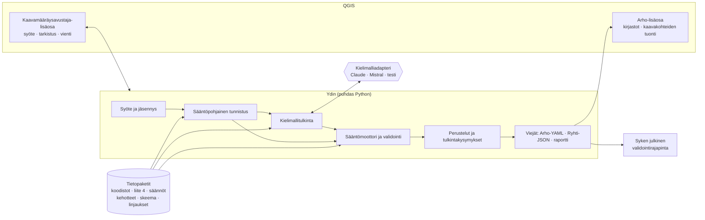

# Kaavamääräysavustaja – toteutussuunnitelma

*Työkalu sanallisten kaava- ja yleismääräysten muuntamiseen Katja-asetuksen mukaiseen rakenteiseen muotoon (Ryhti-JSON) ja Arho-yhteensopiviksi kaavamääräysryhmiksi*

| | |
|---|---|
| Versio | 0.1 – luonnos kommentoitavaksi |
| Päivämäärä | 22.11.2026 |
| Työnimi | Kaavamääräysavustaja (nimi tarkentuu) |
| Toteutus | yksi kehittäjä tekoälyavusteisesti, kaavoittajat sisällön asiantuntijoina |
| Pohja-aineisto | säilön `lahtoaineistot/`-kansio (liite C) ja Arho-lisäosan lähdekoodi ([GispoCoding/arho-qgis-plugin](https://github.com/GispoCoding/arho-qgis-plugin)) |

**Lähtöoletukset (vahvistettu 22.11.2026):**

- Ensimmäinen versio on **erillinen QGIS-lisäosa**, joka tuottaa Arhon kirjastomuotoa ja Ryhti-JSONia ilman muutoksia Arhoon. Käyttöliittymäintegraatio Arhoon tehdään myöhemmin yhdessä Gispon kanssa.
- Tampereen voimassa olevista yleiskaavoista on **vektorimuotoiset kaavakohteet**, joten muunnetut kaavamääräysryhmät voidaan myöhemmin kytkeä geometrioihin.
- **Määräystekstit saa lähettää kielimallille, kaava-PDF:iä ei.** Käyttäjä kopioi merkintöjen otsikot ja määräystekstit sovellukseen (tai teksti poimitaan PDF:stä paikallisesti). Claude API:n tilalle on voitava vaihtaa esim. Mistral API tai vastaava.
- Toteutuksen tekee **yksi kehittäjä tekoälyavusteisesti**.

---

## Sisällys

1. [Tiivistelmä](#1-tiivistelmä)
2. [Tausta, tavoitteet ja rajaukset](#2-tausta-tavoitteet-ja-rajaukset)
3. [Lähtöaineistot ja keskeiset havainnot](#3-lähtöaineistot-ja-keskeiset-havainnot)
4. [Ratkaisun periaatteet](#4-ratkaisun-periaatteet)
5. [Käyttötapaukset](#5-käyttötapaukset)
6. [Arkkitehtuuri](#6-arkkitehtuuri)
7. [Käyttöliittymä](#7-käyttöliittymä)
8. [Esimerkkejä muunnoksista](#8-esimerkkejä-muunnoksista)
9. [Kaavakohteiden kytkentä vektoriaineistoon](#9-kaavakohteiden-kytkentä-vektoriaineistoon)
10. [Laadunvarmistus ja arviointi](#10-laadunvarmistus-ja-arviointi)
11. [Muutoksiin varautuminen](#11-muutoksiin-varautuminen)
12. [Vaiheistus ja työmääräarvio](#12-vaiheistus-ja-työmääräarvio)
13. [Riskit](#13-riskit)
14. [Avoimet kysymykset ja Tampereen linjattavat asiat](#14-avoimet-kysymykset-ja-tampereen-linjattavat-asiat)
15. [Seuraavat askeleet](#15-seuraavat-askeleet)

Liitteet: [A Hakemistorakenne](#liite-a-hakemistorakenne) · [B Sääntöluettelo v1](#liite-b-sääntöluettelo-v1) · [C Lähteet](#liite-c-lähteet)

---

## 1 Tiivistelmä

**Tarve.** Uudet kaavat on toimitettava Ryhtiin valtakunnallisesti yhteentoimivassa tietomallimuodossa (laki 431/2023, 5 §, jota sovelletaan 1.1.2029 alkaen). Kaavamääräysten koneluettava sisältö määräytyy Katja-asetuksen (YM 311/2024, muutos 393/2025) koodistoista ja esitystavasta. Tampereella on lisäksi voimassa olevia yleiskaavoja, joiden määräykset ovat vain sanallisina, esimerkiksi kantakaupungin voimassa olevien yleiskaavamerkintöjen kooste 1.9.2025 (Tampereen PDF, ei tässä säilössä). Kaavoittajan ei pitäisi joutua opettelemaan satoja koodiarvoja ja teknisiä sääntöjä voidakseen kirjoittaa määräyksen.

**Ratkaisu.** Kaavamääräysavustaja on erillinen, Arho-yhteensopiva QGIS-lisäosa, jonka ytimenä on QGIS:stä riippumaton Python-kirjasto. Avustaja

1. ottaa vastaan merkintöjen otsikot ja määräystekstit (kirjoitettuna, PDF:stä kopioituna tai PDF:stä paikallisesti poimittuna) ja jäsentää ne määräysyksiköiksi
2. tunnistaa ensin sääntöpohjaisesti kaiken, minkä voi: Katja-asetuksen liitteen 4 vakiomääräykset, Tampereen aiemmin hyväksymät tulkinnat sekä numeroarvot ja yksiköt
3. käyttää kielimallia (aluksi Claude, vaihdettavissa esim. Mistraliin) vain jäljelle jäävään tulkintaan. Malli voi valita vain voimassa olevista koodiarvoista, ja sen on perusteltava valintansa lainauksilla lähdetekstistä.
4. tarkistaa jokaisen ehdotuksen sääntömoottorilla (Katja, oppaan säännöt, Ryhdin validointisäännöt)
5. näyttää käyttäjälle ehdotuksen kaavoittajan kielellä sekä perustelut, varmuusasteen ja **tulkintakysymykset**. Käyttäjän vastaukset tallentuvat Tampereen **linjauksiksi**, joita sovelletaan jatkossa automaattisesti.
6. vie tuloksen Arhon kaavamääräysryhmäkirjastoksi (YAML), Ryhti-JSONiksi ja muunnosraportiksi. Tulos validoidaan paikallisesti ja halutessa Syken julkisella validointirajapinnalla.

**Muutoksiin varautuminen.** Kaikki muuttuva tieto on versioituja **tietopaketteja**, ei ohjelmakoodia: koodistot, Katja-liite 4, säännöt, kehotteet, Ryhdin skeema ja Tampereen linjaukset. Tietopaketin päivitys tuottaa vaikutusanalyysin (mitkä jo muunnetut määräykset muuttuvat) ja ajaa regressioarvioinnin testiaineistolla.

**Tietosuoja ja riippumattomuus.** Kielimallille lähetetään vain käyttäjän hyväksymä määräysteksti, ei PDF-tiedostoja. API-avain tallennetaan QGISin salattuun tunnistetietovarastoon. Avustaja ei tarvitse taustajärjestelmää. Ilman kielimallia se toimii rajoitetusti: sääntöpohjainen tunnistus ja rakenteistus käsin toimivat silti.

**Vaiheet.** 0 käynnistys ja tekninen piikki → 1 ydin ja sääntöpohjainen muunnos (komentorivi) → 2 kielimalli, perustelut ja tulkintakysymykset → 3 QGIS-lisäosa ja pilotti → 4 kytkentä Tampereen vektoriaineistoon ja koko kaavan vienti → 5 integraatio Arhon käyttöliittymään yhdessä Gispon kanssa ja tuki uusien kaavojen laatimiseen. Työmääräarvio: pilotoitava lisäosa noin 12–18 kehitysviikossa, kytkentä noin 15–23 viikossa (luku 12).

---

## 2 Tausta, tavoitteet ja rajaukset

### 2.1 Tarve ja säädöspohja

- **Laki rakennetun ympäristön tietojärjestelmästä (431/2023)**
  - 5 §: kunnan on toimitettava kaavoitukseen liittyvät tiedot viivytyksettä valtakunnallisesti yhteentoimivassa ja koneluettavassa muodossa. Kaavaehdotus, hyväksytty kaava ja lainvoimainen kaava toimitetaan myös tietomallimuodossa (5 § 2 mom.).
  - 5 §:ää sovelletaan 1.1.2029 alkaen (14 §).
  - Voimassa oleville kaavoille Ryhtissä on oma VOOKA-soveltamisprofiilinsa. Se, kuinka pitkälle voimassa olevien kaavojen määräykset rakenteistetaan, on Tampereen linjattava asia (luku 14).
- **Katja-asetus (YM 311/2024, muutos 393/2025)**
  - Liitteet 1–3 ovat koodistot (kaavamääräyslaji, kaavamääräyksen lisätiedon laji, yleiskaavan oikeusvaikutukset). Liite 4 määrittää vakiomuotoisen esitystavan.
  - 2 §: liitteen 4 määräysten tietosisältöä saa täsmentää sanallisella määräyksellä, kirjaintunnukseen saa lisätä numeroindeksin ja otsikko saa poiketa liitteestä, jos tietosisältö on laajempi.
- **Kehitys jatkuu**
  - YM:n [muistio 16.2.2026](<../lahtoaineistot/katja/LIITE 2_MUISTIO_Katja-asetuksen ja Yhteentoimivuusalustan koodistojen tunnistetut muutostarpeet.pdf>) listaa 36 muutostarvetta: koodien siirtoja koodistosta toiseen, uusia ja poistettavia koodeja sekä määräysrakenteiden muutoksia. KATJA III -päivityksen aikataulu on auki.
  - [Opas tietomallimuotoisten kaavamääräysten laatimiseen](<../lahtoaineistot/katja/Liite 1_LUONNOS_Opas tietomallimuotoisten kaavamääräysten laatimiseen.pdf>) on luonnos (16.2.2026).
  - Ryhdin rajapintaan tulee muutoksia kuukausijulkaisuina (esim. 2026-release-11).
  - Arho kehittyy aktiivisesti; esimerkiksi kirjastojen tiedostomuodolla on versionumero (`format_version`).

### 2.2 Tavoitteet

| # | Tavoite |
|---|---|
| T1 | Muuntaa voimassa olevien kaavojen sanalliset kaava- ja yleismääräykset Katja-asetuksen mukaiseen rakenteiseen muotoon niin, että alkuperäinen oikeudellinen sisältö säilyy muuttumattomana. |
| T2 | Perustella jokainen muunnospäätös ymmärrettävästi: miksi juuri tämä koodi, lisätieto, otsikko ja kirjaintunnus. |
| T3 | Tunnistaa monitulkintaiset kohdat, esittää vaihtoehdot seurauksineen ja antaa käyttäjän ratkaista ne. Ratkaisut hyödynnetään jatkossa. |
| T4 | Tukea uusien määräysten laatimista: kaavoittaja kirjoittaa sisällön, avustaja ehdottaa rakenteen, Katja-otsikon ja kirjaintunnuksen sekä huomauttaa ristiriidoista. |
| T5 | Kestää koodistojen, asetuksen, oppaan, Ryhdin ja Arhon muutokset ilman uudelleenkirjoitusta. |
| T6 | Toimia ilman taustajärjestelmää; kielimallitoimittaja on vaihdettavissa. |
| T7 | Integroitua Arhoon: ensin tiedostomuotojen ja Arhon tuontitoimintojen kautta, myöhemmin käyttöliittymätasolla. |

### 2.3 Alustavat onnistumisen mittarit

Tavoitearvot sovitaan vaiheessa 0. Ne mitataan testiaineistolla (luku 10).

| Mittari | Alustava tavoite |
|---|---|
| Merkinnät, joiden ehdotus hyväksytään sellaisenaan | ≥ 70 % |
| Korkean varmuuden ehdotuksista oikein | ≥ 98 % |
| Tunnetuista monitulkintaisista kohdista nousee tulkintakysymykseksi | ≥ 90 % |
| Voimassa olevan kaavan määräystekstin muutokset | 0 kpl (tarkistetaan koneellisesti) |
| Muunnetut ryhmät latautuvat Arhoon ja läpäisevät Ryhdin määräystason validoinnin | 100 % hyväksytyistä |
| Käsittelyaika merkintää kohden verrattuna käsin tehtyyn | vähintään puolittuu |

### 2.4 Rajaukset

- Kielimallille ei lähetetä PDF-tiedostoja eikä kuvia. Teksti kopioidaan tai poimitaan PDF:stä paikallisesti, ja käyttäjä vahvistaa lähetettävän sisällön.
- Skannatuista kaavoista (esim. koosteen Vuoreksen osayleiskaavat) teksti syötetään käsin. Paikallinen tekstintunnistus (OCR) on mahdollinen myöhempi lisä.
- Avustaja ei hyväksy kaavaa eikä tee oikeudellisia ratkaisuja käyttäjän puolesta. Ihminen hyväksyy aina muunnoksen.
- Kaavakartan digitointi ei kuulu avustajaan. Olemassa olevan vektoriaineiston kytkentä kuuluu (luku 9).
- Kaava-asian elinkaari-, käsittely- ja vuorovaikutustiedot hoidetaan Arhossa.

---

## 3 Lähtöaineistot ja keskeiset havainnot

### 3.1 Kaavamääräyksen rakenne ja vastaavuudet

Oppaan (luku 2.1) mukaan rakenteinen kaavamääräys muodostuu kaavamääräysryhmästä (otsikko ja kirjaintunnus) sekä sen kaavamääräyksistä. Kaavamääräyksellä on laji, mahdollinen arvo ja lisätiedot; sanallisella määräyksellä lisäksi teksti ja sanallisen määräyksen lajit. **Sanallinen teksti on kaavan oikeusvaikutteista sisältöä. Koodit ovat sen koneluettavaa luokittelua.**

| Käsite | Ryhti-JSON ([planService](../lahtoaineistot/ryhti-openapi/planService_openapi.json)) | Arhon kirjasto-YAML (`format_version: 2`) |
|---|---|---|
| Kaavamääräysryhmä | `PlanRegulationGroup`: `planRegulationGroupKey`, `titleOfPlanRegulation`, `letterIdentifier`, `groupNumber`, `colorNumber`, `planRegulations[]`, `planRecommendations[]` | `plan_regulation_groups[]`: `heading`, `letter_code`, `color_code`, `group_number`, `category`, `plan_regulations`, `plan_propositions` |
| Kaavamääräys | `PlanRegulation`: `type` (kaavamääräyslajin URI), `value`, `additionalInformations[]`, `verbalRegulations[]`, `planThemes[]`, `regulationNumber`, `subjectIdentifiers`, `lifeCycleStatus` | `plan_regulations[]`: `regulation_code`, arvokentät (`value_data_type`, `text_value`, `numeric_value` …), `additional_information`, `verbal_regulation_types`, `regulation_number`, `subject_identifiers` |
| Lisätieto | `AdditionalInformation`: `type` (lisätiedon lajin URI), `value` (esim. `CodeValue`) | `additional_information[]`: `type`, `code_value` / muut arvokentät |
| Sanallinen määräys | `type` = `sanallinenMaarays` tai sen alakoodi, `value` = `LocalizedTextValue`, `verbalRegulations` ≥ 1 | `regulation_code: sanallinenMaarays`, `text_value`, `verbal_regulation_types` |
| Yleismääräysryhmä | `GeneralRegulationGroup` | Ei kirjastomuodossa; Arhossa kaavan yleismääräykset syötetään kaavalle |
| Kaavasuositus | `PlanRecommendation` | `plan_propositions[]` |
| Kaavakohde ja liitos | `PlanObject`, `PlanRegulationGroupRelations` | Arhon tietokanta; Tuo kaavakohteita -toiminto |

### 3.2 Koodistot

Koodistot on tallennettu kansioon koodistopalvelun JSON-muodossa:

| Koodisto | Sisältö |
|---|---|
| [Kaavamääräyslaji](../lahtoaineistot/koodistot/codelist_RY_Kaavamaarayslaji.json) | 268 koodia (261 voimassa, 7 poistettu 18.6.2025), kuusitasoinen hierarkia. Määrityshierarkiat (laajennukset): Aluevaraus 92, Yleiskaava 200, Asemakaava 233, Maakuntakaava 110, Suure 46 koodia. |
| [Kaavamääräyksen lisätiedon laji](../lahtoaineistot/koodistot/codelist_RY_Kaavamaarayksen_Lisatiedonlaji.json) | 52 koodia. Laajennukset: Yleiskaava 47, Asemakaava 43, Maakuntakaava 35, Suure 11. |
| [Sanallisen kaavamääräyksen laji](../lahtoaineistot/koodistot/codelist_RY_Sanallisen_Kaavamaarayksen_Laji.json) | 39 koodia, esim. kehittämisperiaate, liikenne, ympäristöarvot, kaupan ohjaus. |

Havainnot:

- **Koodien kuvaukset ovat käyttökelpoisia semanttisia määritelmiä.** Ne kertovat esimerkiksi, että koodi liittyy alueeseen, tai että kehittämisvyöhykkeeseen tulee liittää sanallinen määräys. Kuvaukset näytetään käyttäjälle perusteluina ja annetaan kielimallille kontekstiksi.
- **Otsikkotason koodeja ei saa käyttää määräyksissä.** Ne tunnistetaan kuvauksesta ("Koodistoa jäsentävä otsikkotason koodi…") ja Ryhdin säännöstä `req-codelist-codevalue-headerlevel`, eivät pelkästä hierarkiatasosta.
- **Määrityshierarkiat ratkaisevat paljon:**
  - mitkä koodit kuuluvat millekin kaavatasolle
  - mitkä koodit vaativat arvon (Suure)
  - mitkä koodit voivat saada lisätiedoksi pääkäyttötarkoituksen (Aluevaraus)
- **URIt ovat pysyviä.** Syken vastauksen mukaan kuvaukset eivät muutu, vaan muutokset tehdään uusina koodeina ja koodistoversioina. Muunnoksiin tallennetaan siksi aina koodin URI ja koodistoversio.

### 3.3 Katja-asetuksen liite 4 koneluettavana

[LIITE 3 Esitystavan tekniset yksityiskohdat](<../lahtoaineistot/katja/LIITE 3_Esitystavan tekniset yksityiskohdat.xlsx>) sisältää liitteen 4 taulukkoina: Asemakaava 256, Yleiskaava 360 ja Maakuntakaava 226 riviä. Sarakkeina ovat mm. luokka, geometria, kirjaintunnus, otsikko, enintään 3 kaavamääräyslajia, enintään 5 lisätietoa arvoineen sekä esitystavan tyylitiedot. Taulukko on avustajan tärkein **vakiomääräysluettelo**. Esimerkiksi yleiskaavan *C Keskustatoimintojen alue* on `keskustatoimintojenAlue` + `paakayttotarkoitus`.

Taulukossa on laatuongelmia (oma tarkistus 22.11.2026). Yleiskaavavälilehdellä 13 koodiarvoa on ristiriidassa koodistojen kanssa:

- poistuneita koodeja: `muuArkeologinenKohde`, `valtakunnallisestiMerkittavaArkeologinenKohde`
- väärään sarakkeeseen päätyneitä arvoja: `tuulivoimalaAlue` ja `aurinkovoimalaAlue` lisätiedon lajina, arvot `11` ja `12`, jäsentymätön `code;registryCode=…`

Lisäksi joillakin riveillä koodi on koodistossa olemassa, mutta vastaavuus on semanttisesti epäilyttävä, esim. *LV Venesatama → kanava*. Asemakaava- ja maakuntakaavavälilehdillä on vastaavia havaintoja. **Johtopäätös:** tietopaketin rakentaja tarkistaa taulukon koodistoja vasten ja tuottaa laaturaportin. Korjaukset kirjataan erilliseen, perusteltuun korjaustiedostoon eikä alkuperäistä muokata.

### 3.4 Oppaan ja asetuksen säännöt

Oppaasta saadaan suoraan sääntömoottorin sisältö (kokonaisluettelo liitteessä B). Keskeisimmät:

- Jokaisella kaavamääräyksellä on vähintään yksi kaavamääräyslaji (3.1).
- Sanallisella määräyksellä on aina vähintään yksi sanallisen määräyksen laji (3.2).
- Yleismääräykset koskevat koko kaava-aluetta. Tiettyjä kaavakohteita koskevat määräykset kohdistetaan niihin kohteisiin (3.2.1).
- Kaavakohteella on oltava muukin kuin sanallinen tai suureellinen määräys (3.3, 3.3.9).
- Aluemaisen kohteen ryhmässä kaikilla muilla kuin sanallisilla määräyksillä on sama lisätieto, pääkäyttötarkoitus tai osa-alue. Alueeseen liittyy vain yksi tällainen ryhmä. Piste- ja viivakohteet eivät saa kumpaakaan (3.3.1).
- Pääkäyttötarkoituksen voi antaa vain Aluevaraus-hierarkian koodille (3.3.1, alaviite 18).
- Kehittämisvyöhykkeeseen liittyy aina sanallinen suunnittelumääräys, ja se on aina aluemainen (3.3.3.1).
- Yhteystarve on käytännössä aina viivamainen (3.3.3.2).
- Suureellinen määräys on yksinkertainen: yksi koodi ja yksi arvo. Lisätiedoista sallitaan vain *ehdottomasti noudatettava* ja *käyttötarkoituskohdistus* (3.3.9).
- Jos koodiyhdistelmä löytyy liitteestä 4, käytetään sen otsikkoa. Omassa yhdistelmässä ei saa käyttää mitään liitteen 4 otsikkoa (3.1.1).
- Kaavasuosituksessa ei käytetä velvoittavia ilmauksia, kuten "tulee" tai "täytyy" (2.3.4).

### 3.5 Ryhdin validointi

- Arhon mukana on Ryhdin validointisääntöjen luettelo paluuviesteineen (`resources/configs/validointisaantojen_paluuarvot.csv`, 249 sääntöä). Noin 30 niistä koskee määräyksiä, esim.:
  - kaavamääräyslaji ei ole sallittu kaavalajilla
  - sanallisen määräyksen lajit puuttuvat
  - suureen arvo puuttuu tai on väärää tyyppiä
  - otsikkotason koodi
  - kirjaintunnus puuttuu pääkäyttötarkoitusryhmästä

  Avustaja toteuttaa nämä säännöt paikallisesti ja käyttää samoja selkokielisiä viestejä.
- **Syken julkinen validointirajapinta** (Ryhti Plan Public Validate API): `POST https://api.ymparisto.fi/ryhti/plan-public/api/Plan/Validate?planType=…&administrativeAreaIdentifiers=…` validoi yksittäisen kaavan ilman kaava-asiaa. API-avain (`Ocp-Apim-Subscription-Key`) saadaan rekisteröitymällä osoitteessa api-developer.ymparisto.fi (testiportaali api-test-developer.ymparisto.fi). → **Validointi onnistuu ilman Arhon taustajärjestelmää** (luku 6.11).
- Arhon taustajärjestelmä validoi kaavan ja lähettää sen Ryhtiin. Tämä on olemassa oleva toiminto.

### 3.6 Arho-lisäosa

Havainnot lähdekoodista (GispoCoding/arho-qgis-plugin):

- QGIS 3.40–4.x, lisenssi GPLv2.
- Ei kolmannen osapuolen Python-riippuvuuksia; käytössä vain QGISin mukana tulevat, esim. PyYAML. Verkkoliikenne kulkee Qt:n `QNetworkAccessManager`illa ja asetukset `QgsSettings`illä.
- **Kaavamääräysryhmäkirjastot ovat YAML-tiedostoja** (`format_version: 2`, `library_type: regulation_group`), ja käyttäjä voi lisätä omia kirjastojaan. → Tämä on **ensimmäinen integraatiopiste ilman muutoksia Arhoon**.
- Koodiarvot luetaan Arhon tietokannan koodistotauluista. Kirjaston koodien on siis vastattava Arhon tietokannan koodistoversiota (versiotarkistus viennissä).
- **Tuo kaavakohteita** -toiminto tuo lähdetason kohteita kaavakohteiksi ja liittää niihin valitut kaavamääräysryhmät. Se on valmis polku geometrioiden kytkentään (luku 9).
- Ryhti-JSON-kaavan tuonti, validointi ja Ryhtiin lähettäminen tehdään Arhon taustajärjestelmän kautta.

### 3.7 Tampereen kooste: Voimassa olevat yleiskaavamerkinnät 2025

Kooste on 23-sivuinen. Karkean laskennan mukaan siinä on noin 20 yleismääräyslohkoa ja parisataa merkintää, joista merkittävä osa toistuu usealla kartalla samalla tekstillä. Muunnoksen kannalta olennaiset piirteet:

- **Selite on monipalstainen.** Merkinnän nimi on versaalilla ja sitä seuraa määräysteksti. Kirjaintunnus on osin tekstinä (`c-1`, `km`, `R(200)`, `E-jv`, `sv-1`, `ge-1`), osin vain symbolissa: esimerkiksi keskustatoimintojen alueella on pelkkä värilaatikko.
- **Osa yleismääräyksistä koskee vain tiettyjä merkintöjä**, esim. "Yleiskaavan RA ja R -alueilla yleiskaavaa voidaan käyttää MRL 72 §:n mukaisesti rakentamisen ohjaamiseen". Tämä on ristiriidassa oppaan luvun 3.2.1 periaatteen kanssa → tulkintakysymys.
- **Osa numeroarvoista koskee vain osaa kohteista**, esim. "Vähittäiskaupan kerrosalan enimmäismitoitus Kalevassa on 70 000 k-m²" ja "Lahdesjärvi 150 000 k-m², Lielahti 100 000 k-m², Hankkio 40 000 k-m²".
- **Alakohtaisia määräyksiä:** numeroituja osa-alueita (1.–8.) ja valuma-aluekohtaisia määräyksiä muodossa "Alue / teksti".
- **Merkintöjä ilman määräystekstiä** (VESIALUE, RAUTATIE, ERITASOLIITTYMÄ) ja **rajauksia tai informatiivisia merkintöjä** (YLEISKAAVA-ALUEEN RAJA, OSA-ALUEEN RAJA, KANSALLISEN KAUPUNKIPUISTON ALUE, HAKEMUKSEN RAJAUS (KH 7.12.2020)).
- **Tekstinpoiminnan virheitä:**
  - tavutus palstan vaihtuessa ("kau-" / "punkitilaan")
  - pehmeät tavuviivat ("S­EKOITTUNUT")
  - nollaleveät merkit
  - kirjainvirheet ("ERITASOLllTTYMÄ")
  - kadonneet yhdysmerkit ("vapaaajan")
- **Kooste yhdistää useita kaavoja**, esim. Kantakaupungin yleiskaava 2040 (20.1.2020), kantakaupungin vaiheyleiskaavat ja Keskustan strateginen osayleiskaava. Ryhdissä kaava on yksikkö, joten jokainen merkintä on kohdistettava lähdekaavaansa. Lisäksi koosteen teksti on tarkistettava alkuperäistä kaava-asiakirjaa vasten, koska kooste ei ole oikeudellinen alkuperäisasiakirja.
- **Vuoreksen osayleiskaavat (2005, 1995) ovat skannattuja kuvia** → teksti syötetään käsin.
- **Lakiviittaukset ovat vanhentuneita**, esim. MRL (nykyisin alueidenkäyttölaki). Teksti säilytetään sellaisenaan, ja avustaja antaa asiasta vain huomion.

### 3.8 Muutosherkkyys yhteenvetona

Muistion 16.2.2026 esimerkit osoittavat, millaisiin muutoksiin avustajan on kestettävä:

- **Koodin siirto koodistosta toiseen:** *Käyttötarkoituksen osuus kerrosalasta* siirtyisi lisätiedosta kaavamääräyslajiksi.
- **Uudet koodit:** Pysyvä rakennustunnus, Alin sallittu rakentamiskorkeus, Toimintojen rajoittaminen.
- **Poistot:** Alueellinen, Poisluettava käyttötarkoitus sekä sanallisen määräyksen lajit Suunnittelu-, Rakentamis- ja Suojelumääräys.
- **Rakennemuutokset:** MA- ja TT-määräykset.
- **Koodin muuttaminen otsikkotasolle:** Ympäristöhäiriöalue.

Samaan aikaan liitteen 4 taulukko viittaa jo nyt poistuneisiin koodeihin, opas on luonnos ja Ryhdin rajapinta päivittyy kuukausittain. **Muuttuvan tiedon on siksi oltava dataa, ja muunnokset on voitava ajaa uudelleen ja vertailla.**

---

## 4 Ratkaisun periaatteet

| # | Periaate | Mitä se tarkoittaa käytännössä |
|---|---|---|
| P1 | **Ihminen päättää, kone ehdottaa** | Jokainen rakenne on ehdotus, jolla on perustelu ja varmuusaste. Mitään ei viedä ilman hyväksyntää. |
| P2 | **Oikeudellinen teksti on koskematon** | VOOKA-tilassa (voimassa olevan kaavan muunnos) sanallinen teksti siirtyy merkki merkiltä ja tarkistetaan koneellisesti. Laadintatilassa (uusi kaava) muotoiluehdotukset ovat erillisiä ja valinnaisia. |
| P3 | **Sääntöpohjainen ensin, kielimalli toiseksi** | Vakiomääräysluettelo, Tampereen hyväksytyt tulkinnat ja numeroarvojen tunnistus ratkaisevat suuren osan. Kielimalli täydentää ja selittää. Sääntömoottori tarkistaa kaiken. |
| P4 | **Muuttuva tieto on dataa** | Koodistot, liite 4, säännöt, kehotteet, Ryhdin skeema ja linjaukset ovat versioituja tietopaketteja, ja jokaiseen tulokseen leimataan niiden versiot. |
| P5 | **Selitettävyys** | Jokaisella päätöksellä on lainaus lähdetekstistä, viite koodin kuvaukseen tai sääntöön, menetelmä ja varmuusaste. |
| P6 | **Monitulkintaisuus näkyväksi** | Epävarmuutta ei piiloteta keskiarvoon. Siitä tehdään tulkintakysymys, jolla on vaihtoehdot ja seuraukset. |
| P7 | **Opitaan päätöksistä** | Käyttäjän ratkaisut tallentuvat päätöslokiin ja linjauksiksi. Samankaltaiset tapaukset ratkeavat jatkossa samoin, ja jokainen ratkaisu on jäljitettävissä. |
| P8 | **Toimittajariippumattomuus** | Kielimalli on adapterin takana: ensin Claude, toisena Mistral. Kehotteet ja tulosteskeema ovat toimittajasta riippumattomia. |
| P9 | **Tietojen minimointi** | Mallille lähetetään vain määräysteksti ja tarvittava konteksti. Lähetettävä sisältö on esikatseltavissa. PDF:iä ei lähetetä. |
| P10 | **Toimii ilman taustajärjestelmää** | Kaikki toimii työasemalla. Taustapalvelu on myöhempi valinnainen lisä (avainten keskitetty hallinta, yhteinen kirjasto). |

---

## 5 Käyttötapaukset

| # | Käyttötapaus | Kuka | Vaihe |
|---|---|---|---|
| UC1 | **Voimassa olevan kaavan määräysten muunnos erissä**: liitä kopioitu selite tai yleismääräykset → jäsennys → ehdotukset → tarkistus → vienti | paikkatieto- tai kaavoitusasiantuntija | 1–3 |
| UC2 | **Yksittäisen uuden määräyksen laatiminen**: kirjoita otsikko ja teksti → rakenne-ehdotus, Katja-otsikko, kirjaintunnus ja huomautukset reaaliajassa | kaavoittaja | 3, 5 |
| UC3 | **Tulkintakysymysten ratkaiseminen ja linjausten hallinta** | kaavoittaja, pääkäyttäjä | 2–3 |
| UC4 | **Kytkentä vektoriaineistoon**: kohdetason merkintätunnukset ↔ kaavamääräysryhmät → Arhoon tai Ryhti-JSONiksi | paikkatietoasiantuntija | 4 |
| UC5 | **Tietopohjan päivitys ja vaikutusanalyysi**: uusi koodisto- tai asetusversio → mitkä muunnokset muuttuvat → siirtoehdotukset | pääkäyttäjä | 1–3 (jatkuva) |
| UC6 | **Validointi**: paikallinen sääntötarkistus ja valinnaisesti Syken julkinen validointirajapinta | kaikki | 1–4 |
| UC7 | **Muunnosraportti**: määräyskohtaiset perustelut ja päätökset dokumentointia ja laadunvarmistusta varten | kaikki | 1–3 |

**Käyttäjäpolku UC1 (koosteen yksi kartta):**

1. Käyttäjä valitsee *Uusi muunnos*: kaavataso yleiskaava, tila VOOKA, lähdekaava(t) koosteen otsikosta, kartta *Kartta 1 – Yhdyskuntarakenne*.
2. Käyttäjä liittää selitteen tekstin. Avustaja jäsentää sen ja näyttää taulukon: YLEISMÄÄRÄYS-lohkot, merkinnät ja kirjaintunnukset. Käyttäjä korjaa yhdistämiset ja jaot.
3. *Muunna*: sääntöpohjainen vaihe ratkaisee osan heti, ja kielimalli käsittelee loput taustalla. Käyttäjä näkee kustannusarvion ennen lähetystä.
4. Käyttäjä käy läpi kohteet, joilla on tulkintakysymyksiä tai varoituksia, ja hyväksyy loput erissä suodattamalla korkean varmuuden ehdotukset.
5. *Vie*: Arhon kirjasto-YAML, Ryhti-JSON ja muunnosraportti. Kirjasto lisätään Arhoon toiminnolla *Kirjastot* (Kirjastojen hallinta).

**Käyttäjäpolku UC2 (uusi yleiskaava):** Kaavoittaja kirjoittaa "Kerrostalovaltainen asuntoalue. Alueen täydennysrakentamisessa tulee…". Avustaja ehdottaa: AK, `asuinkerrostaloalue` + pääkäyttötarkoitus, Katja-otsikko ja sanallinen määräys lajeineen. Lisäksi se huomauttaa, jos esimerkiksi otsikko on muokattu Katja-otsikoksi, joka ei vastaa koodeja, tai jos teksti sisältää numeroarvon, joka kannattaisi antaa suureellisena määräyksenä.

---

## 6 Arkkitehtuuri

### 6.1 Keskeiset arkkitehtuuripäätökset

| # | Päätös | Perustelu |
|---|---|---|
| A1 | Erillinen QGIS-lisäosa ja **QGIS:stä riippumaton ydin** (`core` ei saa tuoda `qgis`-moduulia) | Ydin on testattavissa ilman QGISia ja ajettavissa komentoriviltä ja CI:ssä, myöhemmin myös palvelimena. Arho-integraatio onnistuu ilman Arhon muutoksia. |
| A2 | **Sisäinen välimalli**, ja viejät Ryhti-JSONiin ja Arho-YAMLiin | Ryhdin tai Arhon muutos vaikuttaa vain viejään. Välimalli kantaa myös perustelut, kysymykset ja lähdeviitteet. |
| A3 | **Hybridimuunnos**: sääntöpohjainen → kielimalli → sääntömoottori | Laatu, kustannus ja selitettävyys paranevat, eikä malli voi keksiä koodeja. |
| A4 | **Tietopaketit** versioituina datatiedostoina ja manifestina | Muutokset hoituvat ilman koodimuutoksia, ja vaikutusanalyysi on mahdollinen. |
| A5 | **Säännöt**: deklaratiivinen metatieto YAMLissa ja tarkistuslogiikka pieninä Python-funktioina | Säännöt on helppo ylläpitää yhden kehittäjän voimin ja testata yksikkötesteillä. Erillistä sääntökieltä ei tarvita. |
| A6 | **Kielimalliadapteri**: ensin Claude virallisella `anthropic`-SDK:lla, toisena Mistral virallisella `mistralai`-SDK:lla | Vaihdettavuus on vaatimus. Molemmille sama kehote ja skeema, ja vaihto hyväksytään arvioinnin perusteella. |
| A7 | **API-avaimet `QgsAuthManager`iin** (salattu, pääsalasanalla suojattu) | Avaimet eivät päädy projektitiedostoon, lokiin tai `QgsSettings`iin selväkielisinä. |
| A8 | **Muunnosprojekti on JSON-tiedosto** (esim. `*.kma.json`) | Muunnos on siirrettävissä ja vertailtavissa, ja sen voi tallentaa Gitiin. Päätökset säilyvät ja muunnoksen voi ajaa uudelleen. |
| A9 | **Lisenssi GPL-2.0-yhteensopiva** | Koodi voidaan myöhemmin yhdistää Arhoon (GPLv2) tai jakaa muille kunnille. |

### 6.2 Kokonaiskuva



### 6.3 Komponentit

| Komponentti | Vastuu | Riippuvuudet |
|---|---|---|
| `core.model` | Välimalli (luku 6.4) ja sen sarjallistus | stdlib |
| `core.ingest` | Tekstin normalisointi (tavutus, pehmeät tavuviivat, nollaleveät merkit), jäsennys määräysyksiköiksi, kaksoiskappaleiden tunnistus, valinnainen paikallinen PDF-tekstinpoiminta | stdlib; valinnaisesti `pypdf` tai `pdfminer.six` |
| `core.match` | Vakiomääräysluettelon ja linjausten täsmäys, sanastopohjainen haku koodien nimistä ja kuvauksista, numeroarvojen ja yksiköiden tunnistus | stdlib |
| `core.llm` | Adapterirajapinta, Claude-, Mistral- ja testiadapterit, kehotepohjat, skeeman generointi, kustannusarvio ja budjettiraja | `anthropic`, `mistralai` (valinnaisia) |
| `core.rules` | Sääntömoottori, korjausehdotukset ja vakavuusluokat | stdlib |
| `core.explain` | Perustelukortit, varmuusasteen laskenta ja lainausten tarkistus | stdlib |
| `core.decisions` | Tulkintakysymykset, päätösloki ja linjaukset (organisaatiokirjasto) | stdlib, PyYAML |
| `knowledge` | Tietopakettien lataus, eheystarkistus, versiot ja muutosvertailu | PyYAML |
| `exporters` | Ryhti-JSON (fragmentit ja koko kaava), Arho-YAML, raportti (HTML/Markdown/CSV), kytkentätaulukko | stdlib, PyYAML |
| `validation` | JSON-skeemavalidointi Ryhdin OpenAPI:sta, sääntöjen ajo, Syken julkinen validointirajapinta | kevyt validaattori (esim. `fastjsonschema`) |
| `tools` | Tietopaketin rakentaja (koodisto-JSON, LIITE 3 -taulukko, Arhon sääntö-CSV, OpenAPI), arviointiajuri, koodistojen muutosvertailu | `openpyxl` (vain kehityskäytössä) |
| `plugin` (QGIS) | Telakka, dialogit, asetukset, taustatehtävät (`QgsTask`), Arho-vienti | QGIS 3.40–4.x (`qgis.PyQt`) |
| `linking` (vaihe 4) | Vektoritasojen kytkentä ja topologiatarkistukset | QGIS |

**Riippuvuuksien toimitus QGISiin.** QGIS ei asenna lisäosien pip-riippuvuuksia automaattisesti. Vaihtoehdot ovat QPIP-tyyppinen asennus, lisäosan oma asennusapuri ja lisäosan mukana toimitettavat paketit. Vaiheessa 0 testataan Tampereen työasemalla (OSGeo4W, välityspalvelin), mikä tapa toimii, ja päätös kirjataan. Välityspalvelinasetukset luetaan QGISista ja välitetään SDK:n HTTP-asiakkaalle. Ydin toimii myös ilman SDK:ita, jolloin käytössä on vain sääntöpohjainen tila.

### 6.4 Välimalli

Välimalli noudattaa Katjan ja Ryhdin käsitteitä, mutta kantaa lisäksi lähdeviitteet, perustelut, kysymykset ja tilat:

```text
ConversionProject            # muunnosprojekti (*.kma.json)
├─ meta: kaavataso, tila (VOOKA | laadinta), lähdekaavat[], kieli, tietopohjan versiot, avustajan versio
├─ sources[]: SourceDocument  # esim. kooste 1.9.2025, kartta, sivu
├─ units[]: SourceUnit        # määräysyksikkö = merkintä + teksti tai yleismääräyslohko
│   ├─ raw_text (muuttumaton), normalized_text, normalization_diff[]
│   ├─ heading_raw, letter_code_raw, section_path ("Kartta 1 > Maankäyttö"), page
│   ├─ source_plans[]          # mihin kaavaan kuuluu (pakollinen ennen Ryhti-vientiä)
│   ├─ geometry_hint: alue | viiva | piste | ?   # käyttäjältä tai vektoriaineistosta
│   ├─ duplicates_of           # sama merkintä toisella kartalla
│   └─ proposal: GroupProposal | GeneralGroupProposal
│       ├─ title{fin,swe}, letter_code, group_kind, geometry_types[], category
│       ├─ regulations[]: RegulationDraft
│       │   ├─ type_code (URI), value (tyypitetty), additional_infos[{type, value}]
│       │   ├─ verbal_types[], themes[], text_span_refs[]   # merkkivälit raw_textiin
│       │   └─ rationale[]: Rationale
│       ├─ recommendations[]: RecommendationDraft
│       ├─ confidence: korkea | keskitaso | matala (+ peruste)
│       ├─ questions[]: InterpretationQuestion
│       ├─ rule_results[]: RuleResult
│       └─ status: ehdotus | muokattu | hyväksytty | hylätty
├─ decisions[]: Decision       # kuka, milloin, mihin kysymykseen, valinta, perustelu, laajuus
└─ provenance[]: run-tiedot    # malli, kehoteversio, tokenit, kustannus, aikaleima
```

`Rationale` = { väite, lainaus (tarkistettu osamerkkijono), tietopohjaviite (esim. "Katja liite 4 / Yleiskaava / C", "Koodin kuvaus: keskustatoimintojenAlue", "Opas 3.3.1"), menetelmä (vakioluettelo | linjaus | kielimalli | sääntö), varmuus }.

### 6.5 Muunnosputki

1. **Syöte**: tekstikenttä, tiedosto tai paikallinen PDF-tekstinpoiminta. Metatiedot: kaavataso (oletus yleiskaava), tila, lähdekaavat, oikeusvaikutteisuus, kartta tai teema.
2. **Normalisointi**: tavutuksen korjaus, pehmeät tavuviivat, nollaleveät merkit, välilyönnit ja epäilyttävät merkkijonot ("ERITASOLllTTYMÄ"). Alkuperäinen ja normalisoitu teksti säilyvät molemmat, ja eroista näytetään vahvistettava lista. VOOKA-tilassa viedään käyttäjän vahvistama teksti.
3. **Jäsennys** sääntöpohjaisesti:
   - YLEISMÄÄRÄYS-lohkot ja niiden otsikot
   - väliotsikot (MAANKÄYTTÖ, LIIKENNEJÄRJESTELMÄ …)
   - versaalimuotoiset merkinnän nimet
   - kirjaintunnuskuviot (`c-1`, `km`, `R(200)`, `E-jv`, `Saa-2` …)
   - numeroidut alakohdat ja muoto "Alue / teksti"

   Tuloksena on jäsennystaulukko, jota käyttäjä voi korjata. Vaikeissa tapauksissa kielimallilta voi pyytää jäsennysehdotuksen, sillä teksti saa lähteä mallille.
4. **Sääntöpohjainen esiluokittelu**:
   - (a) linjauskirjasto, eli Tampereen aiemmin hyväksymä sama otsikko, kirjaintunnus ja teksti
   - (b) vakiomääräysluettelo (otsikko, kirjaintunnus, sumea täsmäys)
   - (c) koodien nimet ja lyhyet nimet (`shortName`)
   - (d) määreiden sanasto ("UUSI" → `uusi`, "KEHITETTÄVÄ" → `kehitettava`, "OHJEELLINEN" → `ohjeellinenSijainti`, "YHTEYSTARVE" → `yhteystarve` …)
   - (e) numeroarvot ja yksiköt (k-m², e=…, dB, %, m, N2000, kV) ja niiden paikkasidonnaisuus (paikannimet tekstissä)
   - (f) yleismääräyksen kohdistusvihjeet ("RA ja R -alueilla", "km-alueiden")
   - (g) lakiviittaukset
5. **Kielimallitulkinta** vain niille yksiköille, joita vaihe 4 ei ratkaissut korkealla varmuudella. Malli saa vaiheen 4 löydökset ja palauttaa skeeman mukaisen ehdotuksen, perustelut lainauksineen, vaihtoehdot ja kysymykset (luku 6.8).
6. **Sääntömoottori**: virheet, varoitukset ja huomiot. Yksiselitteiset korjaukset tehdään automaattisesti ja näytetään; esimerkiksi pääkäyttötarkoitus poistetaan piste- tai viivakohteelta. Muut muuttuvat tulkintakysymyksiksi.
7. **Perustelut ja varmuus** kootaan (luku 6.9), ja tekstin koskemattomuus tarkistetaan: VOOKA-tilassa sanallisten määräysten tekstien on oltava lähdetekstin osia samassa järjestyksessä.
8. **Tarkistus käyttöliittymässä**: hyväksy, muokkaa, ratkaise kysymykset tai kysy uudelleen lisäohjeella.
9. **Vienti ja validointi** (luvut 6.11–6.12).

### 6.6 Tietopaketit ja niiden päivitys

```text
knowledge/
  manifest.yaml                    # aktiiviset versiot + tarkistussummat
  codelists/RY_Kaavamaarayslaji/2025-10-07.json      # koodistopalvelun JSON sellaisenaan
  codelists/RY_Kaavamaarayksen_Lisatiedonlaji/2026-01-12.json
  codelists/RY_Sanallisen_Kaavamaarayksen_Laji/2024-06-25.json
  codelists/oikeusvaik_YK/…, kaavoitusteema/…, kaavaelinkaari/…
  katja/annex4_katja-ii_393-2025.yaml   # LIITE 3 -taulukosta generoitu vakiomääräysluettelo
  katja/annex4_corrections.yaml         # perustellut korjaukset + laaturaportin viite
  rules/rules_v1.yaml                   # sääntöjen metatieto (logiikka core.rules.checks)
  ryhti/schema_2026-release-11.json     # planService OpenAPI → JSON Schema
  ryhti/validation_messages.csv         # sääntö-id → selkokielinen viesti
  prompts/v1/…                          # kehotepohjat ja esimerkit
  org/tampere/linjaukset.yaml           # Tampereen linjaukset (luku 14)
  org/tampere/library/*.yaml            # hyväksytyt muunnokset (uudelleenkäyttö + esimerkit)
```

`manifest.yaml` (esimerkki):

```yaml
tietopohja: TP-2026.11-1
voimassa_alkaen: 2026-11-22
katja: { asetus: "311/2024", muutokset: ["393/2025"], liite4: annex4_katja-ii_393-2025.yaml }
opas: { versio: "luonnos 16.2.2026" }
koodistot:
  RY_Kaavamaarayslaji: { tiedosto: codelists/RY_Kaavamaarayslaji/2025-10-07.json, sha256: "…" }
ryhti: { skeema: ryhti/schema_2026-release-11.json }
saannot: rules/rules_v1.yaml
kehotteet: prompts/v1
linjaukset: org/tampere/linjaukset.yaml
```

**Päivitysprosessi** (UC5), avustajan oma työkalu:

1. Uudet koodistot haetaan koodistopalvelun rajapinnasta (`koodistot.suomi.fi/codelist-api/…`, osoitteet ovat koodisto-JSONin `url`-kentissä) tai tuodaan käsin ladattuina JSON-tiedostoina, kuten nykyiset tiedostot.
2. **Muutosvertailu**: uudet, poistuneet ja muuttuneet koodit, määrityshierarkioiden jäsenyydet sekä otsikkotasoksi muuttuneet koodit.
3. **Vaikutusanalyysi**: mitkä linjauskirjaston ryhmät ja tallennetut muunnosprojektit käyttävät muuttunutta koodia, esim. "14 ryhmää käyttää poistunutta koodia `muuArkeologinenKohde`".
4. **Siirtoehdotukset**: tunnettu vastaavuus sääntöpohjaisesti (siirtotaulukko), muuten kielimalliavusteisesti ja käyttäjän hyväksymänä.
5. **Regressioajo** testiaineistolla (luku 10) ja uuden tietopohjaversion julkaisu. Vanha versio jää käyttöön, kunnes uusi otetaan aktiiviseksi.

Sama malli koskee liitteen 4 uutta versiota (KATJA III), oppaan lopullista versiota (sääntöjen metatieto), Ryhdin julkaisuja (skeema) ja linjauksia. Säännöillä on voimassaoloaika, joten KATJA III:n säännöt voidaan lisätä rinnalle ja ottaa käyttöön valinnalla tai päivämäärän perusteella.

### 6.7 Sääntömoottori

Esimerkki säännön metatiedosta:

```yaml
- id: OPAS-3.3.1-SAMA-LISATIETO
  lahde: "Opas (luonnos 16.2.2026) 3.3.1; Ryhti quality/req-geom-areaobject-additionalinfo-mainuseclass-section-area"
  vakavuus: virhe            # virhe | varoitus | huomio
  kaavatasot: [yleiskaava, asemakaava, maakuntakaava]
  kuvaus: >
    Aluemaisen kohteen kaavamääräysryhmässä kaikilla muilla kuin sanallisilla
    määräyksillä on oltava sama lisätieto: pääkäyttötarkoitus tai osa-alue.
  tarkistus: core.rules.checks.same_primary_use_or_subarea
  korjaukset: [lisaa_puuttuva_lisatieto, jaa_omaksi_ryhmaksi]
  voimassa: { alkaen: 2024-06-11 }
```

Säännöt jaetaan neljään ryhmään:

- **rakenne**: Ryhdin skeema ja pakolliset kentät
- **koodistot**: koodi olemassa ja voimassa, kaavatasolle sallittu, ei otsikkotason koodi, arvotyyppi sallittu
- **Katja ja opas**: liite B
- **laatu**: esim. otsikon ja koodien ristiriita, velvoittavat sanat kaavasuosituksessa, numeroarvo sanallisena vaikka sille olisi suure

Jokainen tulos sisältää selkokielisen viestin ja lähdeviitteen.

### 6.8 Kielimalliadapteri ja kehotteet

**Rajapinta (pseudokoodi):**

```python
class LLMProvider(Protocol):
    name: str
    capabilities: Capabilities   # strict_json_schema, prompt_caching, batch, max_context
    def generate_structured(self, req: StructuredRequest) -> StructuredResponse: ...

# StructuredRequest: static_context (välimuistitettava), task_input, json_schema,
#                    quality ("low"|"medium"|"high"), max_output_tokens, metadata
# StructuredResponse: data, usage (tokenit, arvioitu hinta), model_id, stop_reason, warnings
```

**Claude (ensimmäinen toteutus):**

- Toteutetaan Anthropicin virallisella Python-SDK:lla (`anthropic`).
- Oletusmalli on `claude-opus-5-5`. Malli on vaihdettavissa asetuksista, esim. `claude-sonnet-5-5` tai `claude-haiku-5-5` edullisempiin massa-ajoihin, kun arviointi osoittaa laadun riittävän.
- Tulosteen rakenne pakotetaan JSON-skeemalla (structured outputs, `output_config.format`). **Skeeman koodikentät ovat enumeraatioita**, jotka generoidaan aktiivisesta tietopaketista kaavatason mukaan, joten malli ei voi palauttaa olematonta tai poistunutta koodia.
- Staattinen konteksti välimuistitetaan (prompt caching): koodiluettelo, säännöt ja esimerkit. Tämä laskee massa-ajon kustannuksia selvästi.
- Laatutasoa säädetään `effort`-parametrilla.
- Pitkät vastaukset haetaan virtana (streaming). Kieltäytymisvastaukset (`stop_reason: "refusal"`), aikakatkaisut ja uudelleenyritykset käsitellään hallitusti.
- Suurissa erissä voidaan käyttää eräajorajapintaa (Message Batches, noin 50 % edullisempi, asynkroninen).
- Clauden citations-ominaisuus ei toimi yhdessä rakenteisen tulosteen kanssa. Lähdeviitteet toteutetaan siksi itse: malli palauttaa lainaukset, ja avustaja tarkistaa, että ne löytyvät lähdetekstistä.

**Mistral (toinen toteutus):**

- Toteutetaan virallisella `mistralai`-SDK:lla.
- JSON-skeemaa käytetään, jos valittu malli tukee sitä. Muuten käytetään JSON-tilaa, paikallista skeemavalidointia ja yhtä korjauskierrosta.
- Välimuistitusta ei oleteta, joten kustannusarvio lasketaan erikseen.
- Mistral toimii EU-pohjaisena vaihtoehtona.

**Kehotteiden rakenne** (suomeksi, versioitu `prompts/vN/`):

1. *Järjestelmäohje*:
   - rooli (Katja- ja Ryhti-asiantuntija-avustaja)
   - ehdottomat säännöt: VOOKA-tilassa tekstiä ei muuteta; käytetään vain annettuja koodeja; epävarmuus merkitään kysymykseksi eikä arvata; jokainen väite perustellaan lainauksella
   - tuloksen kuvaus
2. *Staattinen konteksti*, joka välimuistitetaan:
   - kaavatason koodit (koodi, nimi, kuvauksen ydin, laajennusliput)
   - lisätiedon ja sanallisen määräyksen lajit
   - liitteen 4 vakiomääräykset
   - sääntötiivistelmä
   - Tampereen linjaukset
3. *Esimerkit*: hyväksytyistä muunnoksista valitut samankaltaisimmat (sanastohaku, ei upotuksia ensi vaiheessa).
4. *Tehtävä*: määräysyksikkö (otsikko, kirjaintunnus, teksti, väliotsikkopolku, geometriavihje) ja vaiheen 4 löydökset.

**Tulosteskeema (tiivistettynä):**

```text
{ ryhmat: [ { otsikko, kirjaintunnus, ryhmatyyppi (kaavakohde|yleismaarays), geometria[],
              maaraykset: [ { laji<enum>, arvo?, lisatiedot: [ { laji<enum>, arvo? } ],
                              sanallisen_lajit: [<enum>], tekstiviitteet: [lainaus] } ],
              suositukset: [ … ] } ],
  perustelut: [ { vaite, lainaus, tietopohjaviite, varmuus } ],
  vaihtoehdot: [ { kuvaus, miksi_ei_ensisijainen } ],
  tulkintakysymykset: [ { tyyppi<enum>, kysymys, vaihtoehdot: [ { kuvaus, seuraus } ], suositus, peruste } ],
  kokonaisvarmuus<enum> }
```

**Kustannusarvio** (hinnasto 11/2026, tarkistettava ennen käyttöönottoa): Opus 5.5 maksaa 4 $ / 20 $ miljoonaa syöte- / tulostetokenia, ja välimuistista luettu syöte 0,20 $ / milj. Oletuksella 15 000 välimuistitettua ja 2 000 muuta syötetokenia sekä noin 3 000 tulostetokenia (sisältäen päättelyn) yksi merkintä maksaa noin 0,05–0,15 $. Koko koosteen (noin 200 merkintää) muunnos maksaa siten noin 10–30 $ ja arviointiajo 100 merkinnällä noin 5–15 $. Avustaja näyttää arvion ennen ajoa, ja ajolle voi asettaa budjettirajan.

### 6.9 Perustelut ja varmuusaste

Jokaisesta ehdotuksen osasta näytetään **perustelukortti**: mitä ehdotetaan, miksi (lainaus, koodin kuvaus, liitteen 4 rivi tai linjaus), millä menetelmällä, millä varmuudella ja mitkä vaihtoehdot hylättiin ja miksi. Sääntöpohjaisten vaiheiden perustelut tuotetaan malliteksteistä, esim. "Merkinnän nimi vastaa Katja-asetuksen liitteen 4 yleiskaavamääräystä *C Keskustatoimintojen alue*, jonka rakenne on `keskustatoimintojenAlue` + pääkäyttötarkoitus." Kielimallin perustelut tarkistetaan: lainauksen on löydyttävä lähteestä, muuten perustelu hylätään ja varmuus laskee.

**Varmuusaste** ei perustu pelkkään mallin omaan arvioon:

| Taso | Ehdot |
|---|---|
| Korkea | Sama tulos sääntöpohjaisesti (linjaus tai vakiomääräysluettelo) **tai** kielimalli ja sääntöpohjaiset vihjeet ovat yhtä mieltä. Ei sääntövirheitä, ei avoimia kysymyksiä. |
| Keskitaso | Kielimallin ehdotus ilman ristiriitoja, mutta ilman sääntöpohjaista vahvistusta; tai vain huomioita. |
| Matala | Ristiriita (esim. kaksi ajoa eri mieltä pääkoodista, lainaus ei täsmää, sääntövaroitus) tai avoin tulkintakysymys. Edellyttää aina käsittelyä. |

Tasojen osuvuus kalibroidaan testiaineistolla. Esimerkiksi korkean varmuuden ehdotuksia ei näytetä "hyväksy kaikki" -suodattimessa, ennen kuin niiden mitattu osuvuus on ≥ 98 %.

### 6.10 Tulkintakysymykset ja linjaukset

Tulkintakysymys on oma objektinsa. Siihen kuuluvat tyyppi, kysymys, vaihtoehdot ja niiden vaikutus rakenteeseen ja esitystapaan, avustajan suositus perusteluineen sekä käyttäjän ratkaisu ja sen **laajuus**: *tämä merkintä*, *kaikki samankaltaiset tässä projektissa* tai *Tampereen linjaus*. Linjaukset ovat versioituja ja jäljitettäviä (kuka, milloin, miksi). Ne näkyvät ehdotuksissa perusteluina, esim. "Tampereen linjaus L-03, hyväksytty 3/2027".

Tunnistetut kysymystyypit Tampereen koosteen esimerkein:

| # | Tyyppi | Esimerkki koosteesta | Vaihtoehdot | Alustava suositus |
|---|---|---|---|---|
| K1 | Aluevaraus vai osa-alue | c-1 TÄYDENTYVÄ KESKUSTA, KAUPUNKIVIHREÄN KEHITTÄMISALUE | pääkäyttötarkoitus / osa-alue (esim. kehittämisvyöhyke + käyttötarkoituskohdistus) | ratkaistaan vektoriaineiston päällekkäisyydellä (luku 9); muuten osa-alue, jos kirjaintunnus on pienaakkosin tai merkintä on kehittämisperiaateotsikon alla |
| K2 | Sekoittunut käyttötarkoitus | ASUMISEN JA VIRKISTYKSEN SEKOITTUNUT ALUE | määräysyhdistelmä (useita pääkäyttötarkoituksia) / yksi pääkäyttötarkoitus + kohdistus | yhdistelmä (opas 3.3.2); otsikoksi ei liitteen 4 otsikkoa |
| K3 | Yleismääräys koskee vain osaa alueista | "Yleiskaavan RA ja R -alueilla…" | säilytä yleismääräyksenä / lisää rakenteinen tieto kohteisiin / siirrä kohteisiin | VOOKA: teksti säilyy, rakenteinen tieto lisätään (luku 8.3) |
| K4 | Paikkasidonnainen numeroarvo | "…Kalevassa on 70 000 k-m²" | sanallisena / erillinen kaavakohde + sallittu kerrosala + käyttötarkoituskohdistus | VOOKA: sanallisena; uusissa kaavoissa rakenteisena |
| K5 | Ei sopivaa Katja-koodia | VAK-RATAPIHA, KAUPUNKISTRATEGIAN KASVUN JA ELINVOIMAN VYÖHYKE | lähin koodi + sanallinen / kehittämisvyöhyke + kohdistus | lähin perusteltu koodi; tapaus kirjataan Katja-puutelistaan |
| K6 | Informatiivinen merkintä vai määräys | YLEISKAAVA-ALUEEN RAJA; KANSALLISEN KAUPUNKIPUISTON ALUE, HAKEMUKSEN RAJAUS (KH 7.12.2020) | ei kaavamääräys (kaavan rajaus / lähtötieto) / kaavamääräys | ei kaavamääräys, vahvistetaan |
| K7 | Otsikon määreet lisätiedoiksi | UUSI, KEHITETTÄVÄ, OHJEELLINEN, TUTKITTAVA, TARVEALUE | `uusi`, `kehitettava`, `ohjeellinenSijainti`, `yhteystarve`, `vaihtoehtoinen` | sanastoon perustuva ehdotus; yhdistelmät ("TUTKITTAVA OHJEELLINEN") kysytään |
| K8 | Geometriatyyppi | VAIHTOPYSÄKKI, RAITIOTIE | alue / viiva / piste | vektoriaineistosta; muuten käyttäjältä |
| K9 | Alakohtaiset määräykset | Valuma-aluekohtaiset määräykset, numeroidut osa-alueet 1.–8. | yksi ryhmä / ryhmä alakohtaa kohden (indeksoitu kirjaintunnus) | ryhmä alakohtaa kohden, koska kohdistuvat eri alueisiin |
| K10 | Useita aiheita yhdessä tekstissä | KESKUSTATOIMINTOJEN ALUE | yksi sanallinen määräys + useita lajeja / pilkkominen | VOOKA: ei pilkota |
| K11 | Sanallisen määräyksen tyyppi | "Alueen suunnittelussa tulee…" | `sanallinenMaarays` / `suunnittelumaarays` / `rakentamismaarays` / `suojelumaarays` | Tampereen linjaus (opas 3.2: yleiskaavassa harkinnanvarainen) |
| K12 | Poistunut koodi tai vanhentunut viittaus | liitteen 4 `muuArkeologinenKohde` (poistettu 18.6.2025); "MRL 128 §" | korvaava koodi / ennallaan | korvaava koodi; lakiviittaus säilyy tekstissä |
| K13 | Määräys vai suositus | (uudet kaavat) "suositellaan…" | kaavamääräys / kaavasuositus | lähteen jaottelu ratkaisee; ehdotus vain laadintatilassa |
| K14 | Kirjaintunnus | puuttuu tekstistä (C), poikkeaa Katjasta (c-1 vs. C-1) | alkuperäinen / Katjan mukainen | VOOKA: alkuperäinen; puuttuva liitteestä 4 vahvistettuna |
| K15 | Lähdekaava | koosteen merkintä, joka kuuluu johonkin yhdistetyistä kaavoista | valitse kaava(t) | pakollinen ennen Ryhti-vientiä |

### 6.11 Validointi

1. **Skeemavalidointi**: Ryhdin OpenAPI:n komponenttiskeemoista generoitu JSON Schema, Ryhdin julkaisukohtaisesti versioituna.
2. **Paikalliset säännöt**: luvun 6.7 sääntömoottori. Toimii ilman verkkoa.
3. **Syken julkinen validointirajapinta** (valinnainen, käyttäjän oma API-avain): määräysryhmät kääritään testikaavaksi, jossa on synteettiset geometriat ryhmää kohden. Geometria- ja elinkaarisääntöjen virheet suodatetaan pois sääntötunnisteen perusteella. Vaiheesta 4 alkaen validoidaan varsinainen kaava geometrioineen.
4. **Arhossa**: tuonnin jälkeen Arhon oma validointi taustajärjestelmän kautta.
5. **Arho-yhteensopivuus**: kirjasto-YAMLin koodit tarkistetaan Arhon koodistotasoja vasten, jos Arho on ladattuna. Lisäksi automaattinen testi lataa kirjaston Arhon mallilla, jotta `TemplateSyntaxError` ei pääse käyttäjälle asti.

### 6.12 Tulosteet

| Tuloste | Sisältö | Käyttö |
|---|---|---|
| **Arhon kaavamääräysryhmäkirjasto** (YAML, `format_version: 2`) | hyväksytyt ryhmät, kategoria = lähde ja kartta | lisätään Arhoon toiminnolla *Kirjastot*, käytetään piirrettäessä ja *Tuo kaavakohteita* -toiminnossa |
| **Ryhti-JSON** | `planRegulationGroups[]`, `generalRegulationGroups[]`, avaimet UUID:nä; vaiheesta 4 alkaen koko `Plan` (`planObjects`, `planRegulationGroupRelations`) | validointi, Arhon *Tuo kaavasuunnitelma* -toiminto, arkistointi |
| **Muunnosraportti** (HTML/Markdown + CSV) | yksikkökohtaisesti lähdeteksti, rakenne, perustelut, päätökset, avoimet kysymykset, validointi ja tietopohjan versiot | laadunvarmistus, dokumentointi, hyväksyntä |
| **Kytkentätaulukko** (CSV) | vektoriaineiston merkintäarvot ↔ ryhmäavaimet | luku 9 |
| **Katja-puutelista** (CSV/Markdown) | tapaukset, joihin ei löytynyt sopivaa koodia | palaute YM:lle (KATJA III) |

### 6.13 Tietoturva ja tietosuoja

- API-avaimet (Claude, Mistral, Syke) ovat `QgsAuthManager`issa. Kehittäjälle sallitaan myös ympäristömuuttuja. Avaimet eivät koskaan päädy projektitiedostoon, lokiin tai tulosteisiin.
- Mallille lähtevä sisältö on minimoitu (määräysteksti ja konteksti). Halutessa avustaja näyttää lähetettävän sisällön ennen lähetystä.
- Lokit ovat paikallisia. Sisällön lokitus on valittavissa. Telemetriaa ei kerätä.
- Mallitoimittajien palveluehdot (tietojen säilytys, käyttö mallien koulutukseen) tarkistetaan ja kirjataan käyttöönottopäätökseen.
- Kielimallikutsut ajetaan taustatehtävinä (`QgsTask`), jotka voi keskeyttää. QGIS pysyy käytettävänä.

---

## 7 Käyttöliittymä

### 7.1 Telakka

```text
┌ Kaavamääräysavustaja ──────────────────────────────────────────────────────────┐
│ [1 Syöte] [2 Merkinnät] [3 Tarkistus] [4 Vienti]   Tila: VOOKA · Tietopohja TP-2026.11 ✓ │
├──────────────────────────┬─────────────────────────────────────────────────────┤
│ Merkinnät (212)          │ c-1 TÄYDENTYVÄ KESKUSTA        ? 2 tulkintakysymystä │
│ ✔ C   Keskustatoiminto…  │ Lähdeteksti               │ Ehdotettu rakenne        │
│ ? c-1 Täydentyvä kesk…   │ "Aluetta kehitetään       │ Osa-alue: kehittämis-    │
│ ⚠ km  Alue, jolle saa…   │  täydennettävänä…" [▮▮]   │  vyöhyke → keskusta-     │
│ ✔ A   Asumisen alue      │                           │  toimintojen alue        │
│ …                        │                           │ Suunnittelumääräys: …    │
│ Suodata: [Kaikki ▼]      │ ▸ Perustelut ▸ Tekninen näkymä ▸ Esikatselu         │
│ [Hyväksy valitut]        │ [Hyväksy] [Muokkaa] [Kysy uudelleen…] [Hylkää]      │
└──────────────────────────┴─────────────────────────────────────────────────────┘
```

- **Syöte**:
  - tekstikenttä
  - metatiedot (kaavataso, tila, lähdekaavat, kartta)
  - *Poimi PDF:stä paikallisesti* (sivualue → tekstikenttään)
  - jäsennystaulukko, jossa yksiköitä voi yhdistää ja jakaa
- **Merkinnät**: tilakuvakkeet (✔ valmis, ? kysymys, ⚠ sääntövaroitus, ✖ virhe, ⏳ käsittelyssä) ja suodattimet (tila, varmuus, kysymystyyppi, kartta).
- **Tarkistus**:
  - lähdeteksti, jossa korostukset on linkitetty rakenteen osiin
  - rakenne kaavoittajan kielellä, esim. "Pääkäyttötarkoitus: Keskustatoimintojen alue"
  - *Tekninen näkymä* koodeineen ja URIneen
  - *Esikatselu* määräysosan muodossa (otsikko, kirjaintunnus, "Suunnittelumääräys: …")
  - muokkaus koodinvalitsimilla, joissa on haku ja koodin kuvaus. Valitsimet voi toteuttaa Arhon `tree_with_search_widget`in kaltaisina.
- **Vienti**: tulosteiden valinta, validointi ja kirjaston lisäysohje Arhoon.

### 7.2 Tulkintakysymyskortti (esimerkki)

> **Aluevaraus vai osa-alue? – c-1 TÄYDENTYVÄ KESKUSTA**
>
> Merkintä voidaan tulkita kahdella tavalla:
>
> ◉ **Osa-alue: kehittämisvyöhyke, joka kohdistuu keskustatoimintoihin** *(suositus)*. Perustelut: pienaakkosin kirjoitettu tunnus on liitteessä 4 osa-alueille tyypillinen; teksti kuvaa kehittämisperiaatetta ("Aluetta kehitetään…"); keskustatoimintojen alue on selitteessä omana merkintänään; koodin *Kehittämisvyöhyke* kuvaus ohjaa käyttämään käyttötarkoituskohdistusta. Seuraus: kartalla osa-alueen rajaus keskustatoimintojen alueen päällä.
>
> ○ **Aluevaraus: keskustatoimintojen alue, ympäristömuutos "eheytettävä tai tiivistettävä"**, tunnus C-1. Seuraus: kohde on kaavan pohja-aluevaraus. Ei sovi, jos samalla alueella on myös erillinen C-aluevaraus.
>
> ☐ Sovella kaikkiin c-2…c-4-merkintöihin  ☐ Tallenna Tampereen linjaukseksi
>
> *Varmistus vektoriaineistosta (vaihe 4): jos c-1-alueet ovat C-alueiden päällä → osa-alue.*

### 7.3 Asetukset

- Kielimallin toimittaja (Claude / Mistral / ei mallia), malli ja laatutaso.
- API-avaimet (`QgsAuthManager`).
- Budjettiraja ajoa kohden. Näytä lähetettävä sisältö ennen lähetystä (kyllä/ei).
- Tietopohja: aktiivinen versio, päivitys ja muutosvertailu.
- Linjauskirjaston sijainti (verkkolevy tai Git-kansio).
- Syken validointirajapinnan avain ja ympäristö (testi/tuotanto).
- Käyttöliittymän kieli (suomi/ruotsi; Qt Linguist kuten Arhossa).

---

## 8 Esimerkkejä muunnoksista

Esimerkit ovat havainnollistavia. Lopulliset tulkinnat ratkaistaan kaavoittajien kanssa.

### 8.1 KESKUSTATOIMINTOJEN ALUE – sääntöpohjainen tunnistus

| Osa | Ehdotus | Peruste | Varmuus |
|---|---|---|---|
| Otsikko | Keskustatoimintojen alue | Sama kuin Katja-liitteen 4 yleiskaavamääräys → käytetään asetuksen otsikkoa | korkea |
| Kirjaintunnus | C | Liite 4. Koosteessa vain värisymboli → vahvistetaan vektoriaineistosta | keskitaso |
| Aluevaraus | `keskustatoimintojenAlue` + `paakayttotarkoitus` | Liite 4 ja koodin kuvaus | korkea |
| Sanallinen määräys | koko teksti muuttumattomana | VOOKA-tila | korkea |
| Sanallisen määräyksen lajit | esim. `yhdyskuntarakenteenOhjaus`, `kaupanOhjaus`, `liikenne`, `kulttuuriymparisto` | lainaukset: "Suuryksikköjen tulee tukeutua joukkoliikenteen runkolinjastoon", "kulttuuriympäristön arvoihin" | keskitaso |
| Tulkintakysymys | K11: yläkoodi *Sanallinen määräys* vai *Suunnittelumääräys*? K10: kuinka monta lajia? | Tampereen linjaus | – |

### 8.2 c-1 TÄYDENTYVÄ KESKUSTA – monitulkintainen

Lähde: "c-1 TÄYDENTYVÄ KESKUSTA Aluetta kehitetään täydennettävänä keskustatoimintojen alueena. Täydentämisen tulee edistää toimintojen monipuolisuutta ja keskustojen elinvoimaisuutta. Kaukajärven keskusta-alueelle ei saa sijoittaa seudullisia vähittäiskaupan suuryksiköitä. Vähittäiskaupan kerrosalan enimmäismitoitus Kalevassa on 70 000 k-m²."

Kysymykset: K1 (aluevaraus vai osa-alue, ks. 7.2), K4 (Kalevan 70 000 k-m² koskee vain yhtä kohdetta → suositus: säilyy sanallisena), K14 (tunnus c-1 säilyy).

Tulos, kun käyttäjä valitsee osa-alueen, **Arhon kirjastona**:

```yaml
format_version: 2
library_type: regulation_group
name: Tampere – kantakaupungin voimassa olevat yleiskaavamerkinnät (muunnettu)
version: 1
description: Kaavamääräysavustaja 0.3 · tietopohja TP-2026.11-1
plan_regulation_groups:
  - heading:
      fin: Täydentyvä keskusta
    letter_code: c-1
    category: Kantakaupungin yleiskaavayhdistelmä / Kartta 1 / Maankäyttö
    plan_regulations:
      - regulation_code: kehittamisvyohyke
        additional_information:
          - type: osaAlue
          - type: kayttotarkoituskohdistus
            code_value: keskustatoimintojenAlue
      - regulation_code: suunnittelumaarays
        value_data_type: LocalizedText
        text_value:
          fin: "Aluetta kehitetään täydennettävänä keskustatoimintojen alueena. Täydentämisen tulee edistää toimintojen monipuolisuutta ja keskustojen elinvoimaisuutta. Kaukajärven keskusta-alueelle ei saa sijoittaa seudullisia vähittäiskaupan suuryksiköitä. Vähittäiskaupan kerrosalan enimmäismitoitus Kalevassa on 70 000 k-m²."
        verbal_regulation_types: [kehittamisperiaate, taydennysrakentaminen, kaupanOhjaus]
```

Sama **Ryhti-JSONina** (katkelma; avaimet ja elinkaaren tila täydentyvät viennissä):

```json
{
  "planRegulationGroupKey": "6f1d2c9e-…",
  "titleOfPlanRegulation": { "fin": "Täydentyvä keskusta" },
  "letterIdentifier": "c-1",
  "groupNumber": 14,
  "planRegulations": [
    {
      "planRegulationKey": "0b7e…",
      "lifeCycleStatus": "http://uri.suomi.fi/codelist/rytj/kaavaelinkaari/code/…",
      "type": "http://uri.suomi.fi/codelist/rytj/RY_Kaavamaarayslaji/code/kehittamisvyohyke",
      "additionalInformations": [
        { "type": "http://uri.suomi.fi/codelist/rytj/RY_Kaavamaarayksen_Lisatiedonlaji/code/osaAlue" },
        {
          "type": "http://uri.suomi.fi/codelist/rytj/RY_Kaavamaarayksen_Lisatiedonlaji/code/kayttotarkoituskohdistus",
          "value": {
            "dataType": "code",
            "code": "http://uri.suomi.fi/codelist/rytj/RY_Kaavamaarayslaji/code/keskustatoimintojenAlue",
            "codeList": "http://uri.suomi.fi/codelist/rytj/RY_Kaavamaarayslaji"
          }
        }
      ]
    },
    {
      "planRegulationKey": "4c2a…",
      "lifeCycleStatus": "http://uri.suomi.fi/codelist/rytj/kaavaelinkaari/code/…",
      "type": "http://uri.suomi.fi/codelist/rytj/RY_Kaavamaarayslaji/code/suunnittelumaarays",
      "value": {
        "dataType": "localizedText",
        "text": { "fin": "Aluetta kehitetään täydennettävänä keskustatoimintojen alueena. … Vähittäiskaupan kerrosalan enimmäismitoitus Kalevassa on 70 000 k-m²." }
      },
      "verbalRegulations": [
        "http://uri.suomi.fi/codelist/rytj/RY_Sanallisen_Kaavamaarayksen_Laji/code/kehittamisperiaate",
        "http://uri.suomi.fi/codelist/rytj/RY_Sanallisen_Kaavamaarayksen_Laji/code/taydennysrakentaminen",
        "http://uri.suomi.fi/codelist/rytj/RY_Sanallisen_Kaavamaarayksen_Laji/code/kaupanOhjaus"
      ]
    }
  ]
}
```

Sääntömoottori tarkistaa mm.:

- `kehittamisvyohyke` kuuluu yleiskaavan laajennukseen
- kehittämisvyöhykkeellä on sanallinen suunnittelumääräys
- osa-alue on vain aluemaisella kohteella
- käyttötarkoituskohdistuksen arvo on kaavamääräyslaji
- sanallisella määräyksellä on vähintään yksi laji
- teksti on lähteen kanssa merkki merkiltä sama

### 8.3 Yleismääräys, joka koskee vain tiettyjä alueita

Lähde: "YLEISMÄÄRÄYS Yleiskaavan ohjausvaikutus, tuulivoimarakentaminen ja kaupan ohjaus …". Teksti sisältää viisi kappaletta.

- Ehdotus: yleismääräysryhmä otsikolla *Yleiskaavan ohjausvaikutus, tuulivoimarakentaminen ja kaupan ohjaus* ja sanalliset määräykset lajeineen (esim. `yhdyskuntarakenteenOhjaus`, `kaupanOhjaus`).
- **Tulkintakysymys K3**: kappale "Yleiskaavan RA ja R -alueilla yleiskaavaa voidaan käyttää MRL 72 §:n mukaisesti rakentamisen ohjaamiseen" koskee vain RA- ja R-alueita. Vaihtoehdot:
  1. säilytä vain yleismääräyksenä
  2. **säilytä teksti ja lisää RA- ja R-ryhmiin rakenteinen tieto**: lisätieto `rakennusluvanPeruste`, jonka arvo on yleiskaavan oikeusvaikutukset -koodiston koodi `12` ("Yleiskaavan käyttö rakennusluvan myöntämisen perusteena rantavyöhykkeellä, MRL 72 §"), oppaan alaviitteen 12 mukaisesti, sekä tarvittaessa kaavan oikeusvaikutustietoihin *(suositus VOOKA-tilassa)*
  3. siirrä kappale RA- ja R-ryhmien sanalliseksi määräykseksi (laadintatilan oletus)
- Huomio: "MRL" viittaa nykyiseen alueidenkäyttölakiin. Teksti säilyy ennallaan.

---

## 9 Kaavakohteiden kytkentä vektoriaineistoon

Vaihe 4 hyödyntää Tampereen voimassa olevien yleiskaavojen vektoriaineistoa.

1. **Tasojen ja kenttien valinta**: käyttäjä valitsee QGIS-tasot ja kentät, joissa merkintätunnus tai -nimi on (esim. `merkinta = 'c-1'`).
2. **Kytkentäehdotus**: arvot ↔ kaavamääräysryhmät kirjaintunnuksen ja nimen sumealla täsmäyksellä. Kielimalli auttaa vain nimissä. Käyttäjä vahvistaa kytkentätaulukon.
3. **Topologia ratkaisemaan tulkintoja**:
   - Jos c-1-alueet ovat C-alueiden päällä, ne ovat osa-alueita (K1).
   - Pääkäyttötarkoituksen aluevaraukset eivät saa leikata toisiaan.
   - Geometriatyyppi on johdonmukainen ryhmän kanssa (K8).
   - Peittävyys tarkistetaan suhteessa kaavan rajaukseen (Ryhdin sääntö `req-geom-spatialplan-area-reservation-cover`).
4. **Monikäyttöiset kohteet**: alueella voi olla vain yksi pääkäyttötarkoitus- tai osa-alueryhmä. Päällekkäiset teemat (esim. pohjavesialue C-alueen päällä) muodostetaan siksi erillisiksi kaavakohteiksi.
5. **Lähdekaava**: kohteet jaetaan lähdekaavoittain (K15), koska Ryhti-JSON tehdään kaavaa kohden.
6. **Vientitavat**:
   - (a) **ohjattu käyttö Arhon Tuo kaavakohteita -toiminnolla** merkintä kerrallaan, kirjasto valmiina; ei muutoksia Arhoon
   - (b) **koko kaavan Ryhti-JSON** (`planObjects` ja `planRegulationGroupRelations`), joka validoidaan Syken rajapinnalla ja tuodaan Arhoon *Tuo kaavasuunnitelma* -toiminnolla (taustajärjestelmän kautta)
   - (c) myöhemmin eräajo suoraan Arhoon yhdessä Gispon kanssa
7. **Digitaalinen alkuperä**: kaava-asian `digitalOrigin` (koodisto RY_DigitaalinenAlkupera) asetetaan Syken VOOKA-ohjeen mukaan. Tämä on tarkistettava (luku 14).

---

## 10 Laadunvarmistus ja arviointi

### 10.1 Testit

- **Yksikkötestit** (pytest) ytimelle ilman QGISia:
  - normalisointi
  - jäsennys (Tampereen koosteen todelliset katkelmat testitapauksina)
  - numeroarvojen tunnistus
  - säännöt (jokaiselle säännölle läpäisevä ja hylkäävä tapaus)
  - viejät (Ryhti-skeema, Arho-YAML)
  - tietopaketin rakentaja (LIITE 3 -taulukon laaturaportti)
- **Kielimallitestit ilman verkkoa**: tallennetut vastaukset ja testiadapteri. CI on deterministinen ja ilmainen.
- **Integraatiotestit**: kirjasto latautuu Arhon mallilla, ja käyttöliittymätestit ajetaan kuten Arhossa (pytest, pytest-qt ja QGIS-testiajuri). Testit ajetaan QGIS 3.40:llä ja 4.x:llä.
- **Arkkitehtuuritesti**: `core` ei tuo `qgis`-moduulia.

### 10.2 Kultainen testiaineisto

- 80–120 Tampereen määräysyksikköä, joissa on edustettuina:
  - aluevaraukset, osa-alueet, kehittämisperiaatteet, viiva- ja pistekohteet
  - yleismääräykset, numeroarvot, informatiiviset merkinnät ja alakohtaiset määräykset
- Kaavoittajat annotoivat odotetun rakenteen. Annotointiin kuuluvat myös **hyväksyttävät vaihtoehdot** (oikeita vastauksia voi olla useita) ja **odotetut tulkintakysymykset**.
- Kahden kaavoittajan erimielisyydet ovat arvokasta tietoa: ne osoittavat linjausta vaativat kohdat.

### 10.3 Mittarit

| Mittari | Mitä mitataan |
|---|---|
| Pääkoodin osuvuus | kaavamääräyslaji(t) oikein tai hyväksyttävä vaihtoehto |
| Lisätietojen ja sanallisten lajien F1 | täsmällisyys ja kattavuus |
| Kysymysten kattavuus | tunnetuista monitulkintaisista tapauksista tunnistettu |
| Varmuuden kalibrointi | osuvuus varmuustasoittain, erityisesti varmuudella väärin olevien osuus |
| Automaatioaste | sellaisenaan hyväksyttävien osuus |
| Tekstin koskemattomuus | 0 poikkeamaa |
| Kustannus ja aika | dollaria ja sekunteja yksikköä kohden |

### 10.4 Regressio muutoksissa

Arviointi ajetaan aina, kun tietopaketti, säännöt, kehotteet, malli tai toimittaja muuttuu. Tulokset tallennetaan versioittain. **Uusi malli tai toimittaja otetaan käyttöön vain, jos mittarit eivät heikkene sovittuja rajoja enempää.** Tämä on myös Claude–Mistral-vaihdon hyväksymiskriteeri.

---

## 11 Muutoksiin varautuminen

| Muutos | Miten se näkyy | Avustajan reaktio |
|---|---|---|
| Koodistoon uusia, poistuneita tai siirrettyjä koodeja | koodistopalvelun uusi versio | muutosvertailu → vaikutusanalyysi → siirtoehdotukset → regressio → uusi tietopohja (luku 6.6) |
| Katja-asetuksen muutos (KATJA III) | uusi liite 4 / LIITE 3 -taulukko | rakentaja tuottaa uuden vakiomääräysluettelon ja laaturaportin; säännöt voimassaoloaikoineen; rinnakkaiset versiot |
| Oppaan lopullinen versio | uudet tai muuttuneet periaatteet | sääntöjen metatiedon päivitys, kehotteiden sääntötiivistelmä, linjausten tarkistus |
| Ryhdin rajapintajulkaisu | uusi OpenAPI | skeeman generointi, viejien sopimustestit, julkaisukohtainen skeemaversio |
| Arhon kirjastomuoto tai mallit | uusi `format_version` | viejän versio, integraatiotesti Arhon versioita vasten, yhteydenpito Gispoon |
| Kielimallin vanheneminen tai uusi malli | toimittajan ilmoitus | malli on asetus; arviointiajo ennen vaihtoa |
| Toimittajan vaihto (esim. Mistral) | päätös | adapteri valmiina; arviointi; kustannusarvion päivitys |
| Tampereen linjausten muutos | päätös | linjausversio; vaikutusanalyysi tallennettuihin muunnoksiin |

**Pysyvä periaate**: jokaiseen muunnokseen tallennetaan tietopohjan, kehotteiden, mallin ja avustajan versiot. Vanha muunnos on siten aina selitettävissä, ja sen voi ajaa uudelleen uudella tietopohjalla ja vertailla.

---

## 12 Vaiheistus ja työmääräarvio

Arviot ovat kehitysviikkoja yhdelle kehittäjälle tekoälyavusteisesti. Kaavoittajien työpanos on lueteltu erikseen. Kalenteriaika riippuu sisältötarkistusten aikataulusta.

| Vaihe | Sisältö | Tuotos ja hyväksymiskriteeri | Työmäärä |
|---|---|---|---|
| **0 Käynnistys ja tekninen piikki** | Säilö, CLAUDE.md ja sanasto, projektirunko ja CI. SDK-asennuksen testaus Tampereen QGIS-työasemalla (välityspalvelin). `QgsAuthManager`-avaimet. Syken validointirajapinnan avain ja testi Ryhdin esimerkki-JSONilla. Tietopakettien rakentaja v1 ja laaturaportti. Ensimmäinen linjauspalaveri. | Runko ja CI toimivat; tietopohja TP-2026.11-1 ja laaturaportti; riippuvuuspäätös kirjattu; mittarien tavoitearvot sovittu | 1–2 vk |
| **1 Ydin ja sääntöpohjainen muunnos** | Välimalli, normalisointi ja jäsennys (Tampereen koosteen muoto), vakiomääräysluettelon ja linjausten täsmäys, numeroarvot, sääntömoottori v1 (liite B), viejät (Ryhti-fragmentit, Arho-YAML, raportti), komentorivi (`kma convert`, `kma validate`), testiaineisto v1 (30 yksikköä). | Komentorivi muuntaa koosteen kartan sääntöpohjaisesti; YAML latautuu Arhoon; automaatioaste mitattu | 3–4 vk |
| **2 Kielimalli, perustelut, tulkintakysymykset** | Adapteri, Claude- ja testiadapterit, kehotteet v1, enumeroitu skeema, lainausten tarkistus, varmuus, kysymystyypit K1–K15, päätösloki ja linjaukset, Mistral-adapteri (perustaso), arviointiajuri, testiaineisto 80–120 yksikköön. | Arviointiraportti: mittarit vs. tavoitteet; Mistral-vertailu | 4–6 vk |
| **3 QGIS-lisäosa ja pilotti** | Telakka ja näkymät, taustatehtävät, asetukset, esikatselu, paikallinen PDF-tekstinpoiminta, Syke-validointi, vienti ja ohjeet Arhoon, käyttöohje, sisäinen jakelu. Pilotti 2–3 kaavoittajan kanssa koko koosteella. | Lisäosa v0.x; pilottipalaute ja korjaukset; koosteen määräykset kirjastona Arhossa | 4–6 vk |
| **4 Kytkentä ja koko kaavan vienti** | Tasokytkentä, topologiatarkistukset, lähdekaavoittainen jako, ohjattu Arho-tuonti ja koko kaavan Ryhti-JSON, Syke-validointi geometrioineen. | Yksi voimassa oleva yleiskaava koko Ryhti-JSONina, validoituna ja Arhoon tuotuna | 3–5 vk |
| **5 Arho-integraatio ja uudet kaavat** | Yhdessä Gispon kanssa: "Ehdota rakenne tekstistä" Arhon kaavamääräysryhmälomakkeelle, laadintatilan muotoiluehdotukset, kaavan sisäiset johdonmukaisuustarkistukset, valinnainen taustapalvelu (avainten ja kirjaston keskitetty hallinta), KATJA III -siirto. | Sovitaan erikseen | jatkuva |

**Kaavoittajien työpanos (arvio):** linjauspalaverit 3 × 2 h, testiaineiston annotointi 2–4 päivää, pilotti noin 1–2 viikkoa osa-aikaisesti.

**Aikataulu**: jos työ alkaa joulukuussa 2026, pilotti on mahdollinen keväällä 2027 ja kytkentä kesällä tai syksyllä 2027. Tämä jättää hyvin aikaa ennen 1.1.2029.

### 12.1 Tekoälyavusteinen toteutustapa

- Säilöön tehdään heti `CLAUDE.md`, jossa ovat:
  - sanasto kuten Arhon `CONTEXT.md`:ssä (käyttöliittymäteksti suomeksi, koodi englanniksi)
  - arkkitehtuurisäännöt (ydin ilman QGISia, tietopohja dataa)
  - testien ajokomennot
  - kielto tallentaa avaimia
- Työ tehdään pieninä tehtävinä, joilla on hyväksymiskriteerit (tämän suunnitelman vaiheiden alakohdat). Testit kirjoitetaan ensin ja kultainen aineisto toimii laatuporttina.
- Kehotteet ja säännöt ovat dataa. Niiden muutokset katselmoidaan kuten koodi, ja arviointiajo liitetään muutokseen.
- Kehittäjä katselmoi jokaisen tekoälyn tuottaman muutoksen, ja kaavoittajat katselmoivat sisällön (linjaukset, testiaineisto).

---

## 13 Riskit

| Riski | Tod. | Vaikutus | Hallinta |
|---|---|---|---|
| Voimassa olevan kaavan väärä tulkinta päätyy Ryhtiin | keski | suuri | ihmisen hyväksyntä, teksti koskematon, perustelut ja raportti, varmuuden kalibrointi, linjaukset |
| Kielimallin hallusinaatiot | keski | keski | enumeroidut koodit, lainausten tarkistus, sääntömoottori, testiaineisto laatuporttina |
| KATJA III, koodisto- tai Ryhti-muutokset | suuri | keski | tietopaketit, voimassaoloajat, vaikutusanalyysi, regressio |
| SDK-riippuvuuksien asennus tai välityspalvelin estää käytön | keski | suuri | vaihe 0:n piikki ensimmäisenä; vaihtoehtoiset toimitustavat; sääntöpohjainen tila ilman SDK:ita |
| Arhon sisäiset muutokset rikkovat yhteensopivuuden | keski | keski | integraatio ensin tiedostomuotojen kautta; integraatiotestit; yhteydenpito Gispoon |
| Yhden kehittäjän riippuvuus | suuri | keski | kattava dokumentaatio ja testit, yksinkertainen arkkitehtuuri, avoin lähdekoodi |
| Liitteen 4 taulukon virheet siirtyvät muunnoksiin | keski | keski | laaturaportti, korjaustiedosto, sääntö poistuneille koodeille |
| Koosteen teksti poikkeaa alkuperäisestä kaavasta | keski | keski | lähdekaavan kirjaus, tarkistus alkuperäistä vasten, normalisointierojen vahvistus |
| Kaavoittajat eivät koe avustajaa hyödylliseksi | keski | suuri | yhteissuunnittelu, pilotti, selitettävyys, kaavoittajan kieli teknisen sijaan |
| Kustannukset tai toimittajan hinnoittelu muuttuu | pieni | pieni | sääntöpohjainen ensin, välimuisti, budjettiraja, vaihdettava toimittaja |
| Kansallinen ohjeistus muuttuu (opas luonnos) | suuri | keski | linjaukset versioituina; säännöt lähdeviitteineen; helppo päivittää |

---

## 14 Avoimet kysymykset ja Tampereen linjattavat asiat

| # | Kysymys | Vaihtoehdot | Alustava suositus |
|---|---|---|---|
| L-01 | Muunnoksen yksikkö | kooste / yksittäinen lähdekaava | kirjasto koosteesta (yhteiset ryhmät), Ryhti-vienti lähdekaavoittain |
| L-02 | Kuinka pitkälle voimassa olevat kaavat rakenteistetaan | VOOKA-minimi / määräystason rakenne / koko kaava kohteineen | selvitetään VOOKA-profiilin vaatimukset (Syke); tavoitteena määräystaso + kytkentä |
| L-03 | Sanallisen tekstin pilkkominen | ei pilkota / kappaleittain / aiheittain | VOOKA: ei pilkota |
| L-04 | Sanallisen määräyksen tyyppi yleiskaavassa | `sanallinenMaarays` / alakoodit | linjataan (muistion kohta 34 huomioiden) |
| L-05 | Tiettyjä alueita koskevat yleismääräykset | säilytys / rakenteinen lisäys / siirto | VOOKA: säilytys + rakenteinen lisäys |
| L-06 | Kirjaintunnukset | alkuperäiset / Katjan mukaiset | VOOKA: alkuperäiset |
| L-07 | Paikkasidonnaiset numeroarvot | sanallisena / omat kohteet | VOOKA: sanallisena |
| L-08 | Informatiiviset merkinnät ja rajaukset | ei viedä / lähtötieto / määräys | ei määräyksiksi; vahvistetaan merkinnöittäin |
| L-09 | Sanallisen määräyksen lajien määrä | kaikki relevantit / enintään 3 tärkeintä | enintään 3, pääaihe ensin |
| L-10 | Ruotsinkieliset otsikot | vain suomi / Katja-otsikoiden ruotsinkieliset vastineet automaattisesti | vain suomi (Tampere yksikielinen) |
| L-11 | Linjauskirjaston hallinta | kuka hyväksyy, missä säilytetään | pääkäyttäjä hyväksyy; Git-säilö tai verkkolevy |
| L-12 | Digitaalinen alkuperä (`digitalOrigin`) muunnetuille kaavoille | RY_DigitaalinenAlkupera-koodit | tarkistetaan Syken ohjeista |
| L-13 | Avoimuus ja lisenssi | sisäinen / avoin lähdekoodi muille kunnille | avoin, GPL-2.0-yhteensopiva |
| L-14 | Kaavoitusteemat (`planThemes`) | ei / ehdotetaan | myöhemmin; muistio ehdottaa selkeyttämään suhdetta sanallisen määräyksen lajeihin |

---

## 15 Seuraavat askeleet

Kaksi ensimmäistä viikkoa:

1. Perusta säilö, `CLAUDE.md`, projektirunko (`core`, `knowledge`, `tests`) ja CI.
2. Kirjoita tietopaketin rakentaja:
   - koodisto-JSONit → indeksi (laajennukset, otsikkotason koodit, poistuneet)
   - LIITE 3 -taulukko → vakiomääräysluettelo ja laaturaportti
   - Arhon sääntö-CSV → viestit
   - OpenAPI → JSON Schema
3. Rekisteröidy Syken kehittäjäportaaliin (testiympäristö), hae API-avain ja validoi Ryhdin esimerkki-JSON julkisella rajapinnalla.
4. Testaa `anthropic`- ja `mistralai`-SDK:iden asennus Tampereen QGIS-työasemalla välityspalvelimen takana. Kirjaa riippuvuuspäätös.
5. Valitse koosteesta 30 testiyksikköä ja sovi ensimmäinen linjauspalaveri (L-01–L-07).
6. Selvitä Syken VOOKA-soveltamisprofiilin vaatimukset määräysten ja digitaalisen alkuperän osalta (L-02, L-12).

---

## Liite A: Hakemistorakenne

```text
kaavamaaraysavustaja/                  # säilö
├─ CLAUDE.md                           # ohjeet tekoälyavusteiselle kehitykselle + sanasto
├─ pyproject.toml
├─ kaavamaaraysavustaja/               # QGIS-lisäosa (metadata.txt, plugin.py)
│  ├─ core/                            # EI qgis-importteja
│  │  ├─ model.py  ingest.py  match.py  rules/  explain.py  decisions.py
│  │  └─ llm/  (base.py  claude.py  mistral.py  fake.py  schema.py  budget.py)
│  ├─ knowledge/                       # lataus, eheys, versiot, muutosvertailu
│  ├─ exporters/                       # ryhti_json.py  arho_yaml.py  report.py  mapping_csv.py
│  ├─ validation/                      # schema.py  syke_public_api.py
│  ├─ plugin/                          # telakka, dialogit, asetukset, QgsTask-ajot
│  └─ linking/                         # vaihe 4
├─ knowledge/                          # tietopaketit (luku 6.6)
├─ tools/                              # build_knowledge.py  import_liite3.py  diff_codelists.py  run_eval.py
├─ tests/                              # unit/  golden/  recorded_llm/  qgis/
└─ docs/                               # adr/  linjaukset.md  kayttoohje.md
```

## Liite B: Sääntöluettelo v1

| Tunniste | Sääntö | Lähde | Vakavuus |
|---|---|---|---|
| R-01 | Kaavamääräyslaji on olemassa, voimassa ja kaavatasolle sallittu | Koodisto, laajennukset; Ryhti `rec-codelist-spatialplanregulationtype-plantype-conformity` | virhe |
| R-02 | Ei otsikkotason koodia | Koodin kuvaus; Ryhti `req-codelist-codevalue-headerlevel` | virhe |
| R-03 | Sanallisella määräyksellä on ≥ 1 sanallisen määräyksen laji, muilla ei yhtään | Opas 3.2; Ryhti `…verbal-regulation-codevalue`, `…verbal-regulation-not-allowed` | virhe |
| R-04 | Suure: arvo annettu, oikeaa tyyppiä, > 0; vain yksi suure ryhmässä | Opas 3.3.9; Ryhti `…quantity-value-*`, `…only-one-quantity…` | virhe |
| R-05 | Suureen lisätiedoiksi vain ehdottomasti noudatettava ja käyttötarkoituskohdistus | Opas 3.3.9 alaviite 22 | virhe |
| R-06 | Käyttötarkoituskohdistuksen ja poisluettavan käyttötarkoituksen arvo on kaavamääräyslaji-koodi | Ryhti `…useclasstarget-not-null`, `…codevalue-datatype` | virhe |
| R-07 | Pääkäyttötarkoitus vain Aluevaraus-laajennuksen koodeille; korkeintaan yksi per koodi | Opas 3.3.1 alaviite 18; Ryhti `…mainuseclass-areareservation`, `…only-one-mainuseclass` | virhe |
| R-08 | Aluemaisen ryhmän muilla kuin sanallisilla määräyksillä sama pääkäyttötarkoitus tai osa-alue; ei pisteille ja viivoille | Opas 3.3.1; muistion kohdat 13–14 | virhe |
| R-09 | Kaavakohteella on oltava muukin kuin sanallinen tai suureellinen määräys | Opas 3.3, 3.3.9; Ryhti `…one-without-quantity-mandatory` | virhe |
| R-10 | Yleismääräysryhmässä ei pääkäyttötarkoitusta eikä osa-aluetta; ryhmä ei ole tyhjä | Ryhti `…generalregulationgroup-…` | virhe |
| R-11 | Kirjaintunnus pakollinen, kun ryhmässä on pääkäyttötarkoitus | Ryhti `req-planregulationgroup-letteridentifier-not-null` | virhe |
| R-12 | Kehittämisvyöhyke: aluemainen ja sanallinen suunnittelumääräys mukana | Opas 3.3.3.1; koodin kuvaus | virhe |
| R-13 | Yhteystarve viivamaisella kohteella | Opas 3.3.3.2 | varoitus |
| R-14 | Määräaikaiseen rajoitukseen liittyy väliaikainen määräys | Ryhti `additionalinfotype-temporaryregulation` | virhe |
| R-15 | Otsikko: liitteen 4 yhdistelmälle liitteen otsikko; omalle yhdistelmälle ei mitään liitteen 4 otsikkoa | Opas 3.1.1 | varoitus |
| R-16 | Yleismääräys, joka viittaa tiettyihin merkintöihin | Opas 3.2.1 | huomio (→ K3) |
| R-17 | Kaavasuosituksessa velvoittavia ilmauksia | Opas 2.3.4 | varoitus |
| R-18 | Numeroarvo sanallisessa tekstissä, vaikka sille on suure | Opas 3.3.9 | huomio |
| R-19 | VOOKA-tila: sanallinen teksti merkki merkiltä lähteen mukainen | Periaate P2 | virhe |
| R-20 | Värikoodin muoto `#123456` | Ryhti `req-spatialplanregulationgroup-colorcode-form` | virhe |

## Liite C: Lähteet

**Säilön lähdeaineistot (`lahtoaineistot/`):**

- [Katja-asetus 311/2024 liitteineen (21.11.2026)](../lahtoaineistot/katja/20261121_asetus_kaavamääräysten_ja_kaavakohteiden_esitystavasta.pdf)
- [Liite 1: Opas tietomallimuotoisten kaavamääräysten laatimiseen (luonnos 16.2.2026)](<../lahtoaineistot/katja/Liite 1_LUONNOS_Opas tietomallimuotoisten kaavamääräysten laatimiseen.pdf>)
- [Liite 2: Muistio Katja-asetuksen ja koodistojen muutostarpeista (16.2.2026)](<../lahtoaineistot/katja/LIITE 2_MUISTIO_Katja-asetuksen ja Yhteentoimivuusalustan koodistojen tunnistetut muutostarpeet.pdf>)
- [Liite 3: Esitystavan tekniset yksityiskohdat (xlsx)](<../lahtoaineistot/katja/LIITE 3_Esitystavan tekniset yksityiskohdat.xlsx>)
- [Ryhti planService OpenAPI](../lahtoaineistot/ryhti-openapi/planService_openapi.json) ja [planDataSharingService OpenAPI](../lahtoaineistot/ryhti-openapi/planDataSharingService_openapi.json); jälkimmäistä voi myöhemmin käyttää Ryhtiin jo tallennettujen kaavojen hakuun vertailua varten
- Koodistot: [Kaavamääräyslaji](../lahtoaineistot/koodistot/codelist_RY_Kaavamaarayslaji.json), [Lisätiedon laji](../lahtoaineistot/koodistot/codelist_RY_Kaavamaarayksen_Lisatiedonlaji.json), [Sanallisen määräyksen laji](../lahtoaineistot/koodistot/codelist_RY_Sanallisen_Kaavamaarayksen_Laji.json)
- Tampereen kantakaupungin voimassa olevat yleiskaavamerkinnät 1.9.2025 (Tampereen PDF, ei tässä säilössä)
- Arho-lisäosa ([GispoCoding/arho-qgis-plugin](https://github.com/GispoCoding/arho-qgis-plugin), ei tässä säilössä), erityisesti:
  - `arho_feature_template/core/models.py` (mallit)
  - `core/template_manager.py` (kirjastomuoto)
  - `resources/libraries/regulation_groups/katja_yleiskaava.yaml`
  - `resources/configs/validointisaantojen_paluuarvot.csv`
  - `gui/dialogs/import_features_form.py`

**Verkkolähteet:**

- Laki rakennetun ympäristön tietojärjestelmästä 431/2023: https://www.finlex.fi/fi/lainsaadanto/2023/431
- Katja-asetus 311/2024: https://www.finlex.fi/fi/lainsaadanto/saadoskokoelma/2024/311
- Ryhti – tietomallimuotoinen kaavoitus: https://ryhti.syke.fi/alueidenkaytto/tietomallimuotoinen-kaavoitus/; soveltamisprofiilit (myös VOOKA) ja validointisäännöt
- Ryhti-rajapintakuvaukset: https://github.com/sykefi/Ryhti-rajapintakuvaukset
  - julkinen validointirajapinta: `OpenApi/Alueidenkäyttö/Avoin/`
  - *Koodistojen väliset suhteet 3.11.2026*
  - Ryhdin virhetekstit
- Syken kehittäjäportaali: https://api-developer.ymparisto.fi/ (testi: https://api-test-developer.ymparisto.fi/)
- Kansallinen kaavatietomalli: https://tietomallit.suomi.fi/fi/model/rytj-kaava
- Koodistopalvelu: http://uri.suomi.fi/codelist/rytj/RY_Kaavamaarayslaji (ja muut)
- Arho-lisäosa: https://github.com/GispoCoding/arho-qgis-plugin
